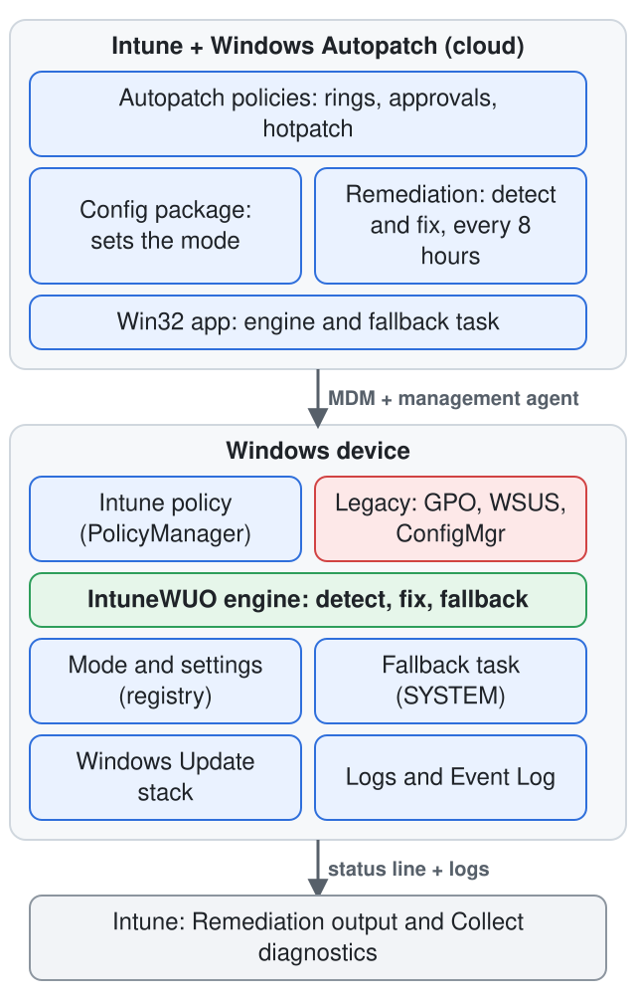
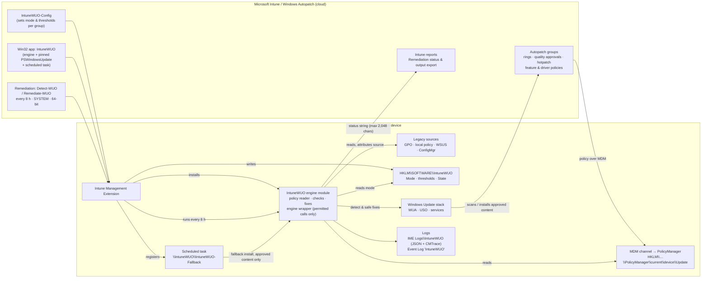
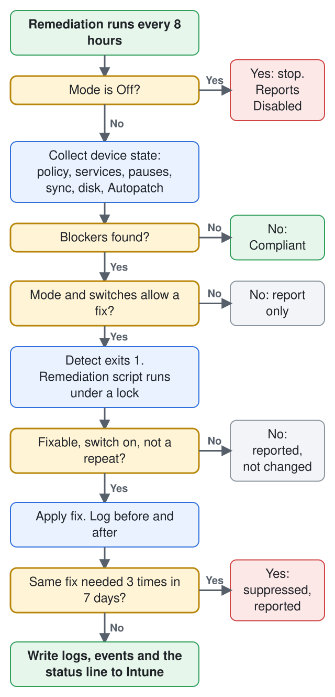
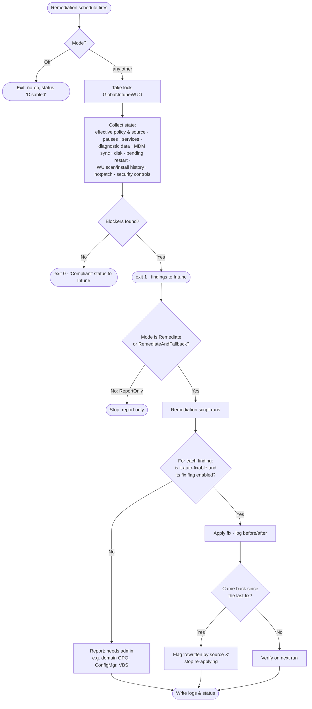
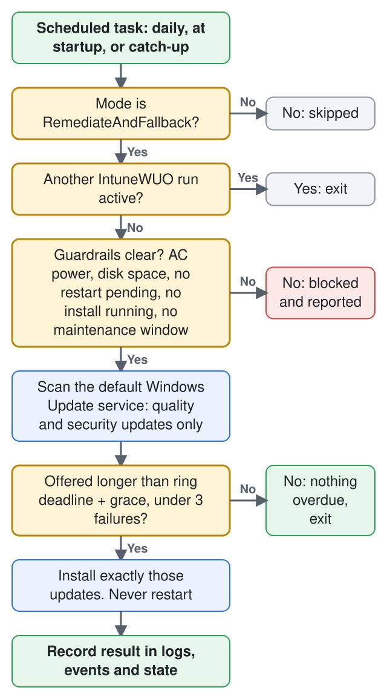
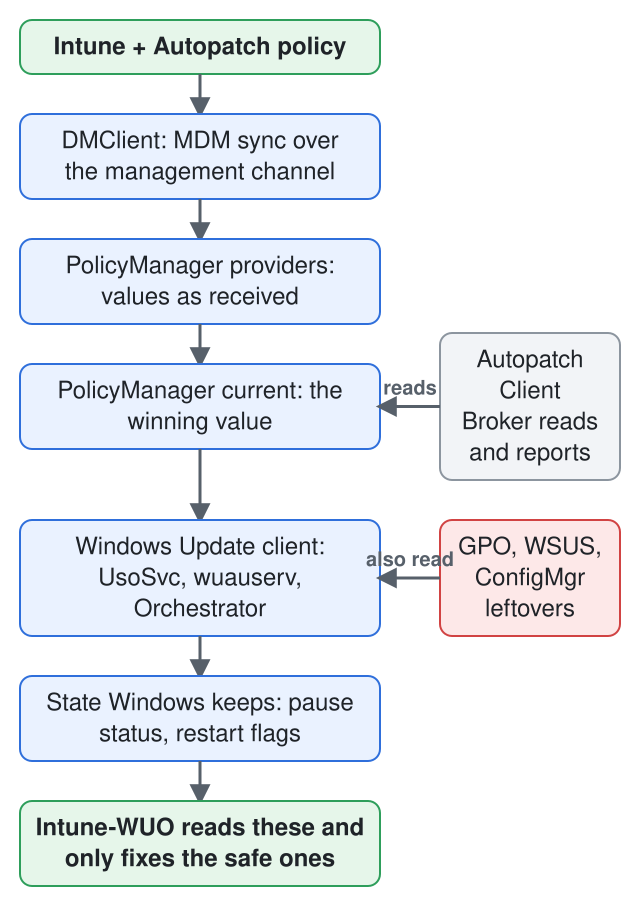
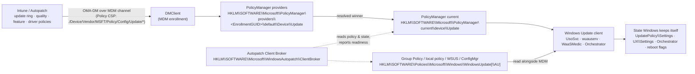

# Intune-WUO: Intune Windows Update Orchestration Platform

**A self-healing layer for Windows Update on Intune-managed devices.** Intune-WUO works alongside [Windows Autopatch](https://learn.microsoft.com/windows/deployment/windows-autopatch/overview/windows-autopatch-overview). It finds the device-side problems that stop Autopatch-approved updates from installing, fixes the safe ones automatically, and, as a last resort, installs the overdue approved update itself. Results go back to Intune and to local logs.

> [!IMPORTANT]
> **Project status: pre-release (v0.2).** All components are implemented and covered by 76 Pester tests, and the read-only paths have been run on one real device (which is now enrolled in Autopatch, ring Test). **The fix actions, the scheduled task and the install paths have not yet been exercised on a real device**, and the PSWindowsUpdate backend has not been tested against the real module. Treat it as pilot-only until the [validation steps](#roadmap) are done. Start every group in `ReportOnly`.

---

## Contents

- [Why Intune-WUO exists](#why-intune-wuo-exists)
- [What it does](#what-it-does)
- [Deploy with an AI agent](#deploy-with-an-ai-agent)
- [How it fits with Windows Autopatch](#how-it-fits-with-windows-autopatch)
- [Architecture](#architecture)
- [How a run works](#how-a-run-works)
- [What it checks and fixes](#what-it-checks-and-fixes)
- [Hotpatch](#hotpatch)
- [Modes and switches](#modes-and-switches)
- [Registry and CSP reference](#registry-and-csp-reference)
- [Prerequisites](#prerequisites)
- [Deployment guide](#deployment-guide)
- [Operating it](#operating-it)
- [Security model](#security-model)
- [Repository layout](#repository-layout)
- [Roadmap](#roadmap)

---

## Why Intune-WUO exists

Windows Autopatch decides **what** a device should install and **when**: rings, approvals, deadlines, hotpatch and feature updates. It doesn't fix the **device** when that device can't carry out the decision. Autopatch raises an alert, and someone has to go and fix the machine.

The devices that miss the monthly security update are rarely missing it because of policy. The usual causes are on the device itself:

- A leftover Group Policy or WSUS setting (`DoNotConnectToWindowsUpdateInternetLocations`, `UseWUServer`, DualScan) still points the device somewhere else.
- A ConfigMgr co-management workload still owns Windows Update.
- A pause is still set, or an update service (`wuauserv`, `UsoSvc`, `WaaSMedicSvc`, `wlidsvc`) has been disabled.
- Diagnostic data is set too low for Autopatch to manage or report on the device.
- MDM sync is stale, disk space is low, or a restart is stuck pending.
- The Windows Update stack is corrupted and every scan fails.

Each of these devices is an **open vulnerability window** and usually a **manual ticket**. These "long tail" devices are what keep a fleet below its compliance target. Autopatch's own target is 95% of devices on the latest quality update.

### Business value

| Outcome | How Intune-WUO delivers it |
|---|---|
| **A shorter exposure window** | Blockers are fixed within hours instead of waiting for an alert, a ticket and an engineer. |
| **Fewer tickets and less manual remediation** | Common causes are fixed automatically, safely and consistently, with a record of each fix. |
| **Better audit and compliance evidence** | Every device reports a structured status to Intune: what was found, what was fixed, and what still needs a person. That gives evidence for patch-compliance controls. |
| **Protects your Autopatch investment** | Works *with* Autopatch rings and approvals and never against them, so the rollout, safeguards and reporting stay intact. |
| **Shows where legacy configuration remains** | It names the source of each conflict (domain GPO, local policy, ConfigMgr, WSUS remnant), so you can fix the source instead of the symptom. |
| **Low risk by design** | Starts in report-only mode. It never restarts devices, never shows UI, never picks update content, and has a central kill switch. |

---

## What it does

Intune-WUO does four things:

1. **Detect.** Every 8 hours it reads the policy Intune actually applied (MDM PolicyManager) and compares it with Group Policy, WSUS and ConfigMgr state. It also checks services, pauses, diagnostic data, MDM sync, disk, pending restarts, the device's security controls, the Windows Update scan and install history, and hotpatch eligibility.
2. **Remediate.** It fixes the safe, well-understood blockers automatically: services, stray pauses, local or stray policy values, a stale sync, and low disk. It reports what it shouldn't touch, such as domain GPO values, ConfigMgr, VBS and Autopatch configuration.
3. **Fall back.** If a device *still* lacks an Autopatch-approved quality update after the ring deadline plus a grace period, a scheduled task installs exactly the updates Windows Update is offering that device. Restarts are suppressed and left to Windows.
4. **Report.** It sends a compact status to Intune through Remediation output, writes detailed JSON and CMTrace logs to the IME logs folder (so they're included in *Collect diagnostics*), and writes to its own Windows Event Log.

**What it never does:** restart a device, prompt the user, change update policy, register or remove update services, install drivers or feature updates, install anything Autopatch hasn't approved, or change VBS, Smart App Control or WDAC settings.

---

## Deploy with an AI agent

Ask ChatGPT, Claude, Grok, Gemini, Copilot or any MCP-capable agent to plan and deploy Intune-WUO in plain language. The project ships an **MCP server** and a **skill** so the agent learns exactly how to do it, and never needs access it should not have.

```bash
# Claude Code: the server (stdio). Needs Node.js 22+
claude mcp add intune-wuo -- npx -y github:bmrepository/Intune-WUOP

# Claude Code: server + skill as a plugin
/plugin install intune-wuo --marketplace bmrepository/Intune-WUOP
```

Then ask: *"Use the Intune-WUO MCP server to help me deploy Intune-WUO to my tenant. My devices are in Windows Autopatch and I want a pilot group first."*

| | |
|---|---|
| **MCP server** | `npx -y github:bmrepository/Intune-WUOP`: prerequisites check, phased plan, exact Microsoft Graph request bodies, mode changes, validation checklists, and a status-line interpreter. **Offline and read-only: it never contacts your tenant and holds no credentials.** |
| **Skill** | [`skills/intune-wuo-deploy/SKILL.md`](skills/intune-wuo-deploy/SKILL.md): the workflow, hard rules and Graph facts in one file |
| **Any other agent** | Point it at [`AGENTS.md`](AGENTS.md) and [`llms.txt`](llms.txt), or paste: *"Read https://raw.githubusercontent.com/bmrepository/Intune-WUOP/main/AGENTS.md and help me deploy Intune-WUO."* |
| **Remote clients (ChatGPT, Grok)** | `node mcp/server.mjs --http` behind HTTPS. See the guide. |
| **Executing changes** | Your agent's own tenant tool, or [`tools/Invoke-WUOGraphRequests.ps1`](tools/Invoke-WUOGraphRequests.ps1), which asks for confirmation on every request |

**The full guide is [docs/AI-AGENTS.md](docs/AI-AGENTS.md)**: configuration for Claude Desktop, VS Code, Cursor, Gemini CLI and Codex CLI; how to connect an agent to your Intune tenant at four access levels from "none" to "write", with the least-privilege permissions to grant; example prompts; and a safety checklist.

> The server and the agent only *plan and generate*. Nothing reaches your tenant unless **you** (or your agent, after you approve each batch) send it. Start every rollout with a pilot group in `ReportOnly`.

---
## How it fits with Windows Autopatch

| Responsibility | Windows Autopatch / Intune | Intune-WUO |
|---|---|---|
| Which updates are approved, and when | ✅ | ❌ never |
| Rings, deferrals, deadlines, grace periods | ✅ | reads them only |
| Hotpatch enrollment, feature and driver rollout | ✅ | reports blockers only |
| Restarts | ✅ native deadline and grace logic | ❌ never |
| Detecting device-side blockers | alerts (some need the optional Client Broker) | ✅ detailed, every 8 hours |
| **Fixing** device-side blockers | ❌ | ✅ within guardrails |
| Installing an overdue approved update when the native path keeps failing | ❌ | ✅ last-resort fallback |
| Fleet reporting | ✅ Autopatch reports | ✅ per-device status in Intune Remediations |

---

## Architecture

<p align="center">
  <picture>
    <source media="(prefers-color-scheme: dark)" srcset="docs/images/architecture-dark.svg">
    
  </picture>
</p>

<details>
<summary>Interactive version (Mermaid)</summary>



</details>

### Components

| Component | Delivered by | Runs as | Purpose |
|---|---|---|---|
| **IntuneWUO engine module** | Win32 app → `%ProgramFiles%\IntuneWUO` | — | Shared logic: config, logging, policy reader, checks, fixes, engine wrapper |
| **Pinned PSWindowsUpdate 2.2.1.5** | Inside the Win32 app, with a SHA-256 manifest | — | Main update backend behind a permitted-calls wrapper. Native WUA COM is the backup |
| **Detect-WUO.ps1 / Remediate-WUO.ps1** | Intune Remediations | SYSTEM, 64-bit | Detect every 8 hours. Fix when a blocker is found and the mode allows it |
| **IntuneWUO-Fallback scheduled task** | Registered by the Win32 app | SYSTEM | Install an overdue approved update, with restarts suppressed |
| **IntuneWUO-Config** | A small Remediation or Win32 app, per group | SYSTEM | Write the mode and thresholds to `HKLM\SOFTWARE\IntuneWUO` |

---

## How a run works

### Detect and remediate (every 8 hours)

<p align="center">
  <picture>
    <source media="(prefers-color-scheme: dark)" srcset="docs/images/detect-remediate-dark.svg">
    
  </picture>
</p>

<details>
<summary>Interactive version (Mermaid)</summary>



</details>

### Fallback install (scheduled task)

<p align="center">
  <picture>
    <source media="(prefers-color-scheme: dark)" srcset="docs/images/fallback-dark.svg">
    
  </picture>
</p>

<details>
<summary>Interactive version (Mermaid)</summary>


</details>

---

## What it checks and fixes

| Area | Check | Default action in `Remediate` mode |
|---|---|---|
| **Policy conflicts** | The values Autopatch flags (`DoNotConnectToWindowsUpdateInternetLocations`, `DisableWindowsUpdateAccess`, `AU\NoAutoUpdate`), compared between PolicyManager and the GPO keys, with each value's source identified | **Report** only for now: the source (domain GPO vs local policy) is not attributed yet, so nothing is removed automatically |
| **WSUS remnants** | `UseWUServer` / `WUServer` / `UpdateServiceUrl`, the `SetPolicyDrivenUpdateSourceFor*` values, DualScan | **Report** |
| **ConfigMgr** | Co-management workloads for Windows Update and Device configuration, and the Software Updates client agent | **Report** only |
| **Pauses** | User pause (not set by policy) | **Fix**. A pause Intune is actively setting is never touched |
| **Services** | `wuauserv`, `UsoSvc`, `BITS`, `WaaSMedicSvc`, `wlidsvc`, `DiagTrack` compared with their *default* start types (trigger-start services are often stopped, and that's healthy) | **Fix** |
| **Update stack** | Scans failing again and again | **Fix**: reset components, at most once per `ResetCooldownDays` |
| **Diagnostic data** | At least *Required* (needed by Autopatch) | **Report** |
| **MDM sync** | Last sync older than `SyncStaleHours` | **Fix**: trigger a sync |
| **Disk** | Free space below `MinFreeDiskGB` | **Fix**: safe cleanup. **Report** if still low afterwards |
| **Restart** | Restart pending past its deadline. `PendingFileRenameOperations` alone doesn't count, because it's often set on healthy devices | **Report** |
| **Compliance** | On the latest approved LCU, or the current hotpatch on top of the current baseline | **Report**, and feeds the fallback |
| **Environment** | Language mode, WDAC/App Control, AppLocker, WinHTTP proxy, endpoint reachability | **Report** as capability flags. Also decides which update backend to use |
| **Autopatch readiness** | The Autopatch Client Broker's latest `ResultsBitmask`/`ErrorCodes` and how recent its readiness timestamp is (see the [registry reference](#5-windows-autopatch-on-the-device)) | **Report** (`AUTOPATCH_READINESS_FAILED`, `AUTOPATCH_READINESS_STALE`; the ring is included in the status line). A missing broker is informational only |

---

## Hotpatch

Hotpatch installs monthly security updates **without a restart** on eligible devices. Intune-WUO handles it like this:

- **Eligibility is checked and reported**: Windows 11 24H2 or later (26H1 has no hotpatch), VBS running, CHPE disabled on Arm64, and the device on the latest baseline.
- **Baseline or hotpatch cycle** is worked out from what Windows Update offers and from install history, **never from a calendar**. Microsoft adds unplanned baseline months; June and September 2026 were baselines.
- **Hotpatch-aware compliance:** on a hotpatch device in a hotpatch month, the absence of a new LCU isn't a finding.
- **The fallback installs what's offered.** In a hotpatch month that's the hotpatch, with no restart. In a baseline month it's the LCU, and the restart is left to Windows.
- **Hotpatch findings implemented today:** `HOTPATCH_UNSUPPORTED_OS`, `HOTPATCH_VBS_NOT_RUNNING`, `HOTPATCH_CHPE_ENABLED`. They are raised only when hotpatch enrollment is known, and reading enrollment is not implemented yet, so they are currently dormant. Planned: `HOTPATCH_NOT_ENROLLED`, `HOTPATCH_OFF_BASELINE`, `HOTPATCH_FELL_BACK_TO_LCU`.
- VBS and CHPE are **never changed** by the tool. Each finding names the Intune policy that fixes it (the `VirtualizationBasedTechnology` CSP, the `DisableCHPE` CSP).

---

## Modes and switches

Everything is controlled centrally through registry values under **`HKLM\SOFTWARE\IntuneWUO`**, which an Intune assignment writes per group. **If a value is missing or invalid, the tool falls back to `ReportOnly`.**

### Modes

| `Mode` | Detect and report | Automatic fixes | Fallback install | Use it for |
|---|---|---|---|---|
| `Off` | ❌ | ❌ | ❌ | **Kill switch.** Everything stops at the next run |
| `ReportOnly` *(default)* | ✅ | ❌ | ❌ | First rollout and baseline measurement |
| `Remediate` | ✅ | ✅ | ❌ | Normal operation once a ring has had a clean ReportOnly cycle |
| `RemediateAndFallback` | ✅ | ✅ | ✅ | The full self-healing layer, enabled ring by ring last |

### Settings *(proposed; finalised in the design doc)*

| Value | Type | Default | Meaning |
|---|---|---|---|
| `Mode` | String | `ReportOnly` | See above |
| `FallbackGraceDays` | DWORD | `3` | Days after the ring's quality-update deadline before the fallback acts |
| `FallbackMaxAttempts` | DWORD | `3` | Failed attempts per update before the fallback stops trying and reports |
| `MinFreeDiskGB` | DWORD | `20` | Disk threshold for the cleanup fix and the fallback guardrail |
| `ResetCooldownDays` | DWORD | `7` | Minimum days between update-stack resets |
| `FixMaxRepeats` | DWORD | `3` | If the same fix is needed this many times within 7 days, something else keeps undoing it: the tool stops re-applying it and reports `Suppressed` |
| `ScanStaleDays` | DWORD | `7` | Days without a successful Windows Update scan before `SCAN_STALE` is raised |
| `SyncStaleHours` | DWORD | `24` | MDM sync age that triggers a sync |
| `FixServices` | DWORD 0/1 | `1` | Allow service fixes |
| `FixPauses` | DWORD 0/1 | `1` | Allow pause fixes |
| `FixPolicyKeys` | DWORD 0/1 | `1` | Allow removal of local or stray policy values |
| `FixSyncAndCleanup` | DWORD 0/1 | `1` | Allow sync triggers and disk cleanup |

`HKLM\SOFTWARE\IntuneWUO\State` is owned by the tool: first-seen dates, attempt counters and write-back tracking. Don't edit it.

### Changing a mode or switch

The supported way is an **Intune assignment**, never manual edits on devices:

1. The build produces one ready-made config package per mode under `out\Config\<Mode>\` (`Detect.ps1` and `Remediate.ps1`). The remediation script writes the mode to `HKLM\SOFTWARE\IntuneWUO`; the detection script checks it, so a device that drifts is corrected on the next run.
2. In **Devices › Scripts and remediations**, create one package per mode, for example `IntuneWUO-Config-ReportOnly`, `-Remediate`, `-RemediateAndFallback` and `-Off`, and assign each to the matching Entra group. Each device must receive **exactly one** config package.
3. To change other settings (see the table above), edit the `__SETTINGS__` block that `build\Build-IntuneWUO.ps1` stamps into the templates in `src\Config\`, rebuild, and update the package. Any number setting is DWORD; the build writes whole numbers as DWORD.
4. **Kill switch:** assign `IntuneWUO-Config-Off` to the affected group (or to all devices) and run it on demand with **Run remediation** for an urgent stop. Every component checks `Mode` at the start of each run.

To check the current mode on a single device:

```powershell
Get-ItemProperty -Path 'HKLM:\SOFTWARE\IntuneWUO'
```

---

## Registry and CSP reference

Every registry location that takes part in orchestrating Windows Update on an Intune-managed device. Each entry is marked **(docs)** when Microsoft documents it, or **(observed)** when it was seen on a real Autopatch-enrolled test device (Windows 11 25H2, build 26100) but is not published. Observed locations can change between Windows builds, so Intune-WUO only ever *reads* them.

### 1. How a setting travels from Intune to the registry

<p align="center">
  <picture>
    <source media="(prefers-color-scheme: dark)" srcset="docs/images/policy-to-registry-dark.svg">
    
  </picture>
</p>

<details>
<summary>Interactive version (Mermaid)</summary>



</details>

Key points:

- **Update rings and Windows Update for Business settings reach the device over the MDM channel (Policy CSP), not through the Intune Management Extension.** The IME only delivers scripts, Win32 apps and Remediations, which is how Intune-WUO itself gets onto the device.
- The MDM policy engine stores what it received per provider, then publishes the **winning** value under `current\device`. **(docs for the default path; observed for the provider and `current` layout)**
- Group Policy and the MDM store are separate. When both set the same thing, Windows applies its own precedence, which is why leftover GPO or WSUS values are the most common cause of "policy not effective". On Windows 11 24H2 builds with KB5101684 (26100.8973) and later, the `IgnoreWindowsUpdateGroupPolicies` MDM policy makes Windows ignore Windows Update Group Policy entirely. **(docs)**

### 2. MDM (Intune) policy store

| Location | What it holds |
|---|---|
| `HKLM\SOFTWARE\Microsoft\PolicyManager\default\Update` **(docs)** | OS defaults and the schema of MDM-managed Update settings |
| `HKLM\SOFTWARE\Microsoft\PolicyManager\providers\<EnrollmentGUID>\default\Device\Update` **(observed)** | Values received from the MDM server, per enrollment, with a `<Setting>_LastWrite` marker beside each. `<EnrollmentGUID>` matches `Enrollments\<GUID>` below. For a user-scope policy the path is `...\default\<UserSID>\...` |
| `HKLM\SOFTWARE\Microsoft\PolicyManager\current\device\Update` **(observed)** | The resolved value Windows uses, plus `<Setting>_ProviderSet` (1 = a provider set it) and `<Setting>_WinningProvider` (the enrollment GUID). **This is the key Intune-WUO and the Autopatch broker read** |
| `HKLM\SOFTWARE\Microsoft\PolicyManager\current\device\System` **(observed)** | System policies that affect updates, notably `AllowTelemetry` (diagnostic data level) and `AllowBuildPreview` |
| `HKLM\SOFTWARE\Microsoft\PolicyManager\current\device\ControlPolicyConflict` **(observed)** | Conflict handling between MDM and Group Policy |
| `HKLM\SOFTWARE\Microsoft\Enrollments\<EnrollmentGUID>` **(docs)** | The MDM enrollment itself. `ProviderID` = `MS DM Server` for Intune; `FirstSync` holds first-sync / ESP status |
| Task Scheduler `\Microsoft\Windows\EnterpriseMgmt\<EnrollmentGUID>\` **(docs)** | The sync tasks the DMClient runs: `PushLaunch`, `PushRenewal`, `Login Schedule created by enrollment client`, and the schedule tasks. Their last-run times show when the device last synced |

### 3. Policy CSP – Update: setting → registry

CSP root: `./Device/Vendor/MSFT/Policy/Config/Update/<Setting>`. Each MDM setting appears under `PolicyManager\current\device\Update\<Setting>`. The Group Policy equivalent is under `HKLM\SOFTWARE\Policies\Microsoft\Windows\WindowsUpdate` unless stated. Only settings relevant to orchestration are listed; the full list is in the [Policy CSP – Update](https://learn.microsoft.com/windows/client-management/mdm/policy-csp-update) reference.

**Deferrals, pauses and targeting** **(docs)**

| CSP setting | Values | GPO registry value |
|---|---|---|
| `DeferQualityUpdatesPeriodInDays` | 0-30 days | `DeferQualityUpdatesPeriodinDays` (+ `DeferQualityUpdates`=1) |
| `DeferFeatureUpdatesPeriodInDays` | 0-365 days | `DeferFeatureUpdatesPeriodinDays` (+ `DeferFeatureUpdates`=1) |
| `PauseQualityUpdates` / `PauseQualityUpdatesStartTime` | 1 = paused; start date `yyyy-mm-dd`. A policy pause lasts 35 days from the start date | `PauseQualityUpdatesStartTime` |
| `PauseFeatureUpdates` / `PauseFeatureUpdatesStartTime` | same, for feature updates | `PauseFeatureUpdatesStartTime` |
| `SetDisablePauseUXAccess` | 1 = remove the user's *Pause updates* control | `SetDisablePauseUXAccess` |
| `SetDisableUXWUAccess` | 1 = remove the user's *Check for updates* control | `SetDisableUXWUAccess` |
| `BranchReadinessLevel` | channel selector. The CSP page lists 16 = Semi-Annual Enterprise Channel (1903 and later); the client-policy page lists 32 for General Availability | `BranchReadinessLevel` |
| `ProductVersion` + `TargetReleaseVersion` | target OS product and version (both needed) | `ProductVersion`, `TargetReleaseVersion` |
| `ExcludeWUDriversInQualityUpdate` | 1 = no drivers with quality updates | `ExcludeWUDriversInQualityUpdate` |
| `AllowOptionalContent` | 1-3 = receive optional updates / CFRs | `SetAllowOptionalContent` |
| `AllowMUUpdateService` | 1 = also scan Microsoft Update (other Microsoft products) | under `WindowsUpdate\AU` (part of *Configure Automatic Updates*) |
| `AllowTemporaryEnterpriseFeatureControl` | 1 = turn on features shipped in monthly updates | `AllowTemporaryEnterpriseFeatureControl` |
| `ManagePreviewBuilds` | Insider preview behaviour | `ManagePreviewBuilds` |
| `DisableWUfBSafeguards` | 1 = skip safeguard holds | per ADMX |

**Deadlines, restarts and installation behaviour** **(docs)**

| CSP setting | Values | Notes |
|---|---|---|
| `ConfigureDeadlineForQualityUpdates` / `...ForFeatureUpdates` | 0-30 days | When set, `AllowAutoUpdate` install/restart behaviour is ignored. **Intune-WUO uses the quality deadline as the base of its fallback timer** |
| `ConfigureDeadlineGracePeriod` / `...GracePeriodForFeatureUpdates` | 0-7 days | Minimum days from installation to automatic restart |
| `ConfigureDeadlineNoAutoReboot...` | 0/1 | Hold restarts until deadline and grace period have passed |
| `AllowAutoUpdate` | 0-5 (6 is written by the Intune *Reset to default* option **(observed)**) | GPO: `AU\AUOptions` / `AU\NoAutoUpdate` |
| `ScheduledInstallDay` / `...Time` / `...EveryWeek` / `...First-FourthWeek` | day 0-7, hour 0-23 | Only with `AllowAutoUpdate` 3 or 4. GPO: `AU\ScheduledInstall*` |
| `ActiveHoursStart` / `ActiveHoursEnd` / `ActiveHoursMaxRange` | hours 0-23; range 8-18 | GPO: `ActiveHoursStart`, `ActiveHoursEnd`, `SetActiveHours` |
| `UpdateNotificationLevel` / `NoUpdateNotificationsDuringActiveHours` | 0-2 / 0-1 | GPO: `SetUpdateNotificationLevel` |
| `SetEDURestart` | 0/1 | Education cart restarts |
| `AutomaticMaintenanceWakeUp` | 0/1 | GPO: `Policies\Microsoft\Windows\Task Scheduler\Maintenance\WakeUp` |
| `ConfigureFeatureUpdateUninstallPeriod` | 2-60 days | Rollback window |
| `AllowAutoWindowsUpdateDownloadOverMeteredNetwork` | 0/1 | |
| `AlwaysAutoRebootAtScheduledTimeMinutes`, `AutoRestart*`, `EngagedRestart*`, `Schedule*RestartWarning`, `SetAutoRestartNotificationDisable` | | **Legacy, not applicable to Windows 11**. Intune-WUO reports their presence as noise only |

**Native maintenance window** (Windows 11 24H2 with KB5077181, build 26100.7840 and later) **(docs)**: `MaintenanceWindowEnabled`, `MaintenanceWindowStartTime`, `MaintenanceWindowDurationHours` (2-24), `MaintenanceWindowRepeatScheduleOption` (1 none / 2 daily / 3 weekly / 4 monthly), `MaintenanceWindowStartDate`, `MaintenanceWindowUpdateActions` (1 download+install+restart / 2 install+restart / 3 restart only), the `MaintenanceWindowWeekly<Day>` flags and the `MaintenanceWindowMonthly*` settings. **When `MaintenanceWindowEnabled` = 1, Intune-WUO's fallback installer stays out of the way completely.**

**Update source (WSUS) and conflicts** **(docs)**

| CSP setting | GPO registry location | Why it matters |
|---|---|---|
| `UpdateServiceUrl`, `UpdateServiceUrlAlternate` | `WindowsUpdate\WUServer`, `WUStatusServer`, `UpdateServiceUrlAlternate` | Points the device at WSUS instead of Windows Update |
| *(GPO only)* | `WindowsUpdate\AU\UseWUServer` = 1 | Tells Automatic Updates to use that server |
| `SetPolicyDrivenUpdateSourceForQualityUpdates` / `...FeatureUpdates` / `...DriverUpdates` / `...OtherUpdates` | `WindowsUpdate\...` | 0 = Windows Update, **1 = WSUS (the default!)**. Only effective when a WSUS URL is set |
| `DisableDualScan` (legacy) | `WindowsUpdate\DisableDualScan` | With a WSUS URL, blocks scans against Windows Update, which blocks Autopatch |
| `DetectionFrequency` | under `WindowsUpdate\AU` | Only effective with a WSUS URL; 1-22 h |
| `IgnoreWindowsUpdateGroupPolicies` | n/a | **1 = ignore all Windows Update Group Policy.** The recommended tenant-wide fix for GPO conflicts (26100.8973 and later) |
| *(GPO only)* | `WindowsUpdate\DoNotConnectToWindowsUpdateInternetLocations` | **Autopatch flags this.** Blocks Windows Update, Store and Delivery Optimization |
| *(GPO only)* | `WindowsUpdate\DisableWindowsUpdateAccess` | **Autopatch flags this** |
| *(GPO only)* | `WindowsUpdate\AU\NoAutoUpdate` | **Autopatch flags this.** 1 = automatic updates off |

### 4. State that Windows maintains itself (read, never written by policy)

| Location | Values | Used by Intune-WUO |
|---|---|---|
| `HKLM\SOFTWARE\Microsoft\WindowsUpdate\UpdatePolicy\Settings` **(docs)** | `PausedQualityStatus`, `PausedFeatureStatus` (0 not paused, 1 paused, 2 auto-resumed); `PausedQualityDate`, `PausedFeatureDate` | Detects pauses. Never written |
| `HKLM\SOFTWARE\Microsoft\WindowsUpdate\UX\Settings` **(observed)** | User-facing state: `PauseQualityUpdatesStartTime/EndTime`, `PauseFeatureUpdatesStartTime/EndTime`, `PauseUpdatesStartTime`, `PauseUpdatesExpiryTime` (set when a user pauses in Settings), `ActiveHoursStart/End`, `IsExpedited`, `RestartNotificationsAllowed2`, `IsContinuousInnovationOptedIn` | **The `Pause*` values are what the pause fix removes** |
| `HKLM\SOFTWARE\Microsoft\WindowsUpdate\Orchestrator` **(docs)** | `\Configurations\UsoDisableAADJAttribution` (hide organisation name in notifications); `ScanBeforeInitialLogonAllowed` under `HKLM\SOFTWARE\Microsoft\Windows\CurrentVersion\WindowsUpdate\Orchestrator` (update before first sign-in) | Reported only |
| `HKLM\SOFTWARE\Microsoft\Windows\CurrentVersion\Component Based Servicing\RebootPending` **(observed)** | Key exists = servicing restart pending | `RESTART_PENDING` |
| `HKLM\SOFTWARE\Microsoft\WindowsUpdate\Auto Update\RebootRequired` **(observed)** | Key exists = Windows Update restart pending | `RESTART_PENDING` |
| `HKLM\SYSTEM\CurrentControlSet\Control\Session Manager` → `PendingFileRenameOperations` | Set on many healthy devices | **Deliberately ignored** |
| `HKLM\SYSTEM\CurrentControlSet\Control\Session Manager\Memory Management` → `HotPatchRestrictions` **(docs)** | 1 = CHPE disabled (Arm64 hotpatch requirement) | `HOTPATCH_CHPE_ENABLED` |
| `HKLM\SOFTWARE\Policies\Microsoft\Windows\DataCollection` and `PolicyManager\current\device\System` → `AllowTelemetry` **(docs)** | 0 off, 1 Required, 2 Enhanced/3 Optional | `DIAGDATA_LOW` (Autopatch needs Required or higher) |
| `HKLM\SOFTWARE\Microsoft\Windows NT\CurrentVersion` **(docs)** | `CurrentBuild`, `UBR`, `DisplayVersion`, `EditionID` | Build / edition checks |
| WMI `root\Microsoft\Windows\DeviceGuard\Win32_DeviceGuard` **(docs)** | `VirtualizationBasedSecurityStatus` (2 = running), code-integrity enforcement | Hotpatch VBS check; WDAC detection |

### 5. Windows Autopatch on the device

| Location | What it is |
|---|---|
| `HKLM\SOFTWARE\Microsoft\WindowsAutopatch\ClientBroker` **(observed)** | Written by the **Windows Autopatch Client Broker**. `Ring` (for example `Test`), `DeviceReadiness` (JSON results per check), `DeviceReadinessTimestamp` (Unix seconds). It also holds a signed access link (`ActionsFeedUri`); **Intune-WUO never reads that value** and you should not paste it into tickets or logs |
| `C:\ProgramData\Microsoft\AutopatchClientBroker\Logs\ClientBroker.log` **(observed)** | CMTrace-format broker log. The line `Completed RunDeviceReadinessChecks. ResultsBitmask=<n>, ErrorCodes=<...>` is the readiness verdict (0 = all pass). **Intune-WUO reads the latest such line** (`AUTOPATCH_READINESS_FAILED`) |
| `C:\Program Files\Windows Autopatch Client Broker\` **(observed)** | Broker binaries (installed as a Win32 app via the *Manage client broker* tenant setting) |
| `%ProgramData%\Microsoft\CMDExtension\Plugins\DeviceReadinessPlugin\Logs\DRCResults.json.log` **(docs, older agent)** | Where Microsoft's documentation says readiness results are written. Newer brokers log to the path above instead |

The broker's own log lists the registry keys Autopatch evaluates, which is a useful map of what *Autopatch itself* treats as relevant **(observed)**: `PolicyManager\current\device\Update`, `Policies\Microsoft\Windows\WindowsUpdate` and `\AU`, `WindowsUpdate\UpdatePolicy\Settings`, the Appraiser and compatibility markers under `Windows NT\CurrentVersion\AppCompatFlags\{Appraiser\RunResults\LastRun, CompatMarkers\*, TargetVersionUpgradeExperienceIndicators\*}`, `CurrentVersion\SideBySide\CorruptionFlags`, `CurrentVersion\WindowsUpdate\OSUpgrade\Rollback`, Microsoft 365 Apps `ClickToRun\Configuration` and `Policies\...\officeupdate`, and `Policies\Microsoft\EdgeUpdate`.

### 6. Other agents that touch the same settings

| Location | Meaning |
|---|---|
| `HKLM\SOFTWARE\Microsoft\CCM`, `C:\Windows\ccmsetup` **(observed)** | ConfigMgr client present. On co-managed devices the *Windows Update policies* workload must be set to Intune, and ConfigMgr client Software Updates settings must not be configured |
| `C:\ProgramData\Microsoft\IntuneManagementExtension\Logs\` **(docs)** | IME logs (`IntuneManagementExtension.log`, `AgentExecutor.log`, `AppWorkload.log`, `HealthScripts.log`). Remediation runs are in `HealthScripts.log`. Intune-WUO writes its own logs in an `IntuneWUO` subfolder here so *Collect diagnostics* picks them up |
| `HKLM\SOFTWARE\Microsoft\IntuneManagementExtension` **(observed)** | IME state |

### 7. What Intune-WUO reads and writes

| Location | Access |
|---|---|
| `PolicyManager\current\device\Update` and `...\System` | **Read** |
| `Policies\Microsoft\Windows\WindowsUpdate`, `\AU`, `\DataCollection` | **Read** (never modified; policy-key fixes are not enabled) |
| `WindowsUpdate\UpdatePolicy\Settings`, `Component Based Servicing\RebootPending`, `Auto Update\RebootRequired`, `Memory Management`, `WindowsAutopatch\ClientBroker` (not `ActionsFeedUri`), the Autopatch `ClientBroker.log` | **Read** |
| `WindowsUpdate\UX\Settings` → the `Pause*` user-pause values | **Write (remove)**, only the pause fix, only when `FixPauses` = 1 and the pause was not set by policy |
| Service start types for `wuauserv`, `UsoSvc`, `BITS`, `WaaSMedicSvc`, `wlidsvc`, `DiagTrack` | **Write**, only when the service is *Disabled* and `FixServices` = 1 |
| `HKLM\SOFTWARE\IntuneWUO` (config) and `\State` (counters) | **Read** config / **write** state |
| Task `\IntuneWUO\IntuneWUO-Fallback`, event log `IntuneWUO`, `%ProgramFiles%\IntuneWUO` | Created by the Win32 app; the task is re-registered if it goes missing |

### 8. Inspecting a device yourself

```powershell
# What Intune delivered, and which enrollment won
Get-ItemProperty 'HKLM:\SOFTWARE\Microsoft\PolicyManager\current\device\Update'

# Any Group Policy / WSUS / local-policy leftovers
Get-ItemProperty 'HKLM:\SOFTWARE\Policies\Microsoft\Windows\WindowsUpdate' -ErrorAction SilentlyContinue
Get-ItemProperty 'HKLM:\SOFTWARE\Policies\Microsoft\Windows\WindowsUpdate\AU' -ErrorAction SilentlyContinue

# Pause, reboot and Autopatch state (do not copy ActionsFeedUri anywhere)
Get-ItemProperty 'HKLM:\SOFTWARE\Microsoft\WindowsUpdate\UpdatePolicy\Settings'
Get-ItemProperty 'HKLM:\SOFTWARE\Microsoft\WindowsAutopatch\ClientBroker' | Select-Object Ring, DeviceReadinessTimestamp

# Latest Autopatch readiness verdict
Select-String -Path "$env:ProgramData\Microsoft\AutopatchClientBroker\Logs\ClientBroker.log" -Pattern 'Completed RunDeviceReadinessChecks' | Select-Object -Last 1

# When did the device last sync with Intune?
Get-ScheduledTask -TaskPath '\Microsoft\Windows\EnterpriseMgmt\*' | Get-ScheduledTaskInfo | Select-Object TaskName, LastRunTime

# Full MDM diagnostics bundle (admin): shows every applied policy and its source
mdmdiagnosticstool.exe -area "DeviceEnrollment;DeviceProvisioning;Autopilot" -zip C:\Temp\mdmdiag.zip
```

---

## Prerequisites

| Area | Requirement |
|---|---|
| **Licensing** | Windows Enterprise E3/E5 (or Microsoft 365 E3/E5/F3, A3/A5, VDA). **Remediations require it.** Business Premium includes Autopatch but not Remediations |
| **Management** | Devices enrolled in Intune and registered with **Windows Autopatch** (groups, quality approval policies). Entra joined or hybrid joined |
| **OS** | Windows 11 Enterprise or Education. 24H2 or later is recommended (needed for hotpatch and `IgnoreWindowsUpdateGroupPolicies`) |
| **PowerShell** | Windows PowerShell 5.1, 64-bit (inbox) |
| **Diagnostic data** | Required level or higher (an Autopatch prerequisite) |
| **Recommended tenant settings** | Install the **Autopatch Client Broker** (Tenant administration › Windows Autopatch › Tenant management › Manage client broker), so Intune-WUO can read Autopatch's readiness results on the device. On builds that support it, deploy **`Update/IgnoreWindowsUpdateGroupPolicies = 1`**, so that leftover Group Policy no longer overrides MDM |
| **App control** | If WDAC/App Control or AppLocker is enforced, allow the IntuneWUO folder by signer (preferred) or by the Intune managed installer. Intune-WUO reports what it finds either way |
| **Code signing** *(recommended)* | A code-signing certificate trusted by the devices, so the build can sign every script and the Remediation can run with *Enforce script signature check* |

---

## Deployment guide

> [!NOTE]
> These steps describe the planned deployment. Package names, file names and commands will be confirmed when the build is finished.

### Step 1: Prepare the tenant

1. **Record a baseline.** Export the Autopatch quality-update and *Autopatch management status* reports, and note the count of *Not ready* and alerted devices. Success is measured against these.
2. **Create Entra device groups:**
   - `IntuneWUO-Pilot`: 10–20 IT devices.
   - Reuse your **Autopatch ring groups** (Test, First, Fast, Broad) for the later rollout.
   - `IntuneWUO-Excluded`: servers, kiosks and shared devices, multi-session/AVD, Windows 365, LTSC.
3. **Turn on the recommended settings** above: the Client Broker, `IgnoreWindowsUpdateGroupPolicies`, and diagnostic data at Required.

### Step 2: Build the package

```powershell
# From the repo root. Only -Version is required.
.\build\Build-IntuneWUO.ps1 -Version 1.0.0 `
    -PSWindowsUpdatePath C:\pinned\PSWindowsUpdate\2.2.1.5 `
    -CertThumbprint <code-signing-cert-thumbprint> `
    -IntuneWinAppUtil C:\tools\IntuneWinAppUtil.exe
```

Nothing is downloaded by the build. You supply a pinned copy of PSWindowsUpdate 2.2.1.5 (for example saved once with `Save-Module PSWindowsUpdate -RequiredVersion 2.2.1.5`) and, optionally, the signing certificate and Microsoft's `IntuneWinAppUtil.exe`.

The build writes to `out\`:
- `Win32\`: the app contents (module, fallback script, install/uninstall scripts, `version.txt`, and `ThirdParty\` with a SHA-256 `manifest.json` if you passed `-PSWindowsUpdatePath`)
- `Win32-Detect\Detect-IntuneWUOApp.ps1`: the app's detection rule, stamped with the version
- `Remediation\`: `Detect-WUO.ps1` and `Remediate-WUO.ps1`
- `Config\<Mode>\`: the four config packages
- `IntuneWUO.intunewin`: only when `-IntuneWinAppUtil` is given

Without `-PSWindowsUpdatePath` the package uses the native Windows Update COM backend only, which is fully supported.

### Step 3: Deploy the Win32 app (engine and scheduled task)

**Apps › Windows › Add › Windows app (Win32)**, then upload `IntuneWUO.intunewin`:

| Setting | Value |
|---|---|
| Install command | `%SystemRoot%\Sysnative\WindowsPowerShell\v1.0\powershell.exe -NoProfile -ExecutionPolicy Bypass -File .\Install-IntuneWUO.ps1` |
| Uninstall command | `%SystemRoot%\Sysnative\WindowsPowerShell\v1.0\powershell.exe -NoProfile -ExecutionPolicy Bypass -File .\Uninstall-IntuneWUO.ps1` |
| Install behaviour | System |
| Device restart behaviour | No specific action |
| Requirements | 64-bit, Windows 11 (minimum build agreed in the design doc) |
| Detection rule | Custom script `Detect-IntuneWUOApp.ps1`: the module version matches **and** the task `\IntuneWUO\IntuneWUO-Fallback` exists |
| Assignment | Required: `IntuneWUO-Pilot` (later the ring groups). Excluded: `IntuneWUO-Excluded` |

The install script:
- copies the files to `%ProgramFiles%\IntuneWUO` and locks the folder down (SYSTEM and Administrators full control, Users read)
- creates the `IntuneWUO` event log
- registers the scheduled task

### Step 4: Deploy the config package

Create **IntuneWUO-Config-ReportOnly** (see [Changing a mode or switch](#changing-a-mode-or-switch)) and assign it to the pilot group. **Start every group in ReportOnly.**

### Step 5: Deploy the detect and remediate Remediation

Go to **Devices › Scripts and remediations › Create**, upload `Detect-WUO.ps1` and `Remediate-WUO.ps1`, and use these settings:

| Setting | Value |
|---|---|
| Run this script using the logged-on credentials | **No** (it runs as SYSTEM) |
| Enforce script signature check | **Yes** if you signed the build, otherwise No |
| Run script in 64-bit PowerShell | **Yes** (required: registry views and PSWindowsUpdate) |
| Schedule | **Hourly, every 8 hours** |
| Assignment | Same groups as the Win32 app. Exclude `IntuneWUO-Excluded` |

### Step 6: Roll out

| Stage | Groups | Mode | Move on when |
|---|---|---|---|
| 1. Pilot | `IntuneWUO-Pilot` | ReportOnly → **Remediate** | 2 Patch Tuesday cycles with no fix-related incidents |
| 2. Rings | Autopatch Test → First → Fast → Broad (one cycle apart) | ReportOnly for 1 cycle → **Remediate** | Each ring has a clean cycle |
| 3. Fallback | Ring by ring, in the same order | **RemediateAndFallback** | The previous ring had a clean fallback cycle |

### Step 7: Verify on a device

```powershell
Get-ScheduledTask -TaskPath '\IntuneWUO\' | Get-ScheduledTaskInfo
Get-ItemProperty 'HKLM:\SOFTWARE\IntuneWUO'
Get-WinEvent -LogName IntuneWUO -MaxEvents 20
Get-ChildItem 'C:\ProgramData\Microsoft\IntuneManagementExtension\Logs\IntuneWUO'
```

In Intune, open the Remediation's **Device status** and add the *Pre-remediation detection output* column, or **Export** it to CSV.

---

## Operating it

### Where results go

| Destination | Contents |
|---|---|
| **Intune Remediation output** | A compact, versioned status string (2,048-character limit), for example:<br>`WUO\|v1\|NonCompliant\|Mode=Remediate\|QU=2026-10B\|HP=NotEnrolled\|F=PAUSE_USER,SVC_UsoSvc\|Fixed=PAUSE_USER` |
| **`…\IntuneManagementExtension\Logs\IntuneWUO\`** | `IntuneWUO.jsonl` (machine-readable) and `IntuneWUO.log` (CMTrace), rotated by size. Collected by *Collect diagnostics* |
| **Event Log `IntuneWUO`** | Fixed event IDs per finding and action, for Event Viewer, Defender XDR or SIEM forwarding |

**Event IDs:**

| ID | Meaning |
|---|---|
| `1001` / `1002` | Detection run complete / skipped because Mode is `Off` |
| `2000–2099` | A finding. Each known finding has a fixed id (see [docs/DESIGN.md](docs/DESIGN.md)); unknown ones use `2099` |
| `3000–3099` | The matching fix was applied (finding id + 1000) |
| `3500–3599` | The matching fix failed (finding id + 1500) |
| `4001` | Fallback installed updates |
| `4002` | Fallback install failed |
| `4003` | Fallback skipped (mode or a guardrail) |
| `4004` | Nothing overdue; the native path is healthy |
| `9000` | Error |

### Troubleshooting

| Symptom | Where to look |
|---|---|
| Device shows *Disabled* | `Mode` is `Off`. Check which config package the device receives |
| A finding keeps returning with "rewritten by DomainGPO" | Fix the GPO, or deploy `IgnoreWindowsUpdateGroupPolicies` |
| The fallback never runs | `Mode` must be `RemediateAndFallback`. Check the guardrail events (`4xxx`) and the task's last result |
| Module load failure (`9xxx`) | WDAC/AppLocker is blocking the bundled module. The engine switches to native COM automatically; allow the folder by signer to restore PSWindowsUpdate |

### Uninstall and rollback

- **Stop immediately:** assign `IntuneWUO-Config-Off`.
- **Remove:** unassign the Remediation, then change the Win32 app assignment to *Uninstall*. This removes the task, the files and the event log. The `HKLM\SOFTWARE\IntuneWUO` key is kept for audit unless you remove it.
- **Nothing to revert:** Intune-WUO never changes Intune or Autopatch policy, so removing it puts nothing back to a different state.

---

## Security model

- **Least surprise.** No restarts, no UI, no policy writes, no service-manager changes, and no installs of content Autopatch hasn't approved.
- **Permitted-calls wrapper.** Only a fixed set of PSWindowsUpdate cmdlets and parameters can be called. `Set-WUSettings`, `Add-/Remove-WUServiceManager`, remoting and job cmdlets, `-MicrosoftUpdate` and `-KBArticleID` are blocked.
- **Supply chain.** PSWindowsUpdate is never downloaded at runtime. A pinned copy is shipped and checked against a SHA-256 manifest before import.
- **Tamper resistance.** Standard users can't write to the program folder, so they can't change what SYSTEM runs.
- **No secrets on devices.** v1 sends no data to external endpoints.
- **Guardrails on every fix.** Domain GPO and ConfigMgr values are never deleted. An active Intune pause is never cleared. A value that gets written back stops being removed. Every change is logged with its before/after state.

---

## Repository layout

```text
src/
  IntuneWUO/            Engine module: config, state, findings, fixes, fallback, engine wrapper, task, logging
  Remediation/          Detect-WUO.ps1, Remediate-WUO.ps1
  Config/               Templates for the per-mode config packages
  Win32/                Invoke-WUOFallback.ps1 (task entry point), Install/Uninstall scripts, app detection rule
tests/                  Pester tests (mocked registry, services, backend and update API)
build/                  Build-IntuneWUO.ps1: staging, PSWindowsUpdate pinning, signing, .intunewin
tools/                  Invoke-WUOValidation.ps1, Invoke-WUOGraphRequests.ps1, New-DiagramImages.ps1
mcp/                    MCP server for AI agents (Node): server.mjs, src/, test/
skills/                 intune-wuo-deploy/SKILL.md (agent skill)
.claude-plugin/         Claude Code plugin + marketplace manifests (skill + MCP server)
AGENTS.md, llms.txt, .mcp.json, package.json   Agent entry points and the npm package for the MCP server
docs/
  DESIGN.md             Design: finding catalogue, guardrails, schemas, event IDs
  AI-AGENTS.md          Deploy with an AI agent: client setup, tenant connection, safety
  findings.json         Machine-readable findings catalogue (used by the MCP server)
  images/               SVG diagrams (light and dark)
  discovery/            Read-only discovery snapshots from test devices
```

On a device the Win32 app installs to `%ProgramFiles%\IntuneWUO\` (`Module\`, `ThirdParty\`, `Invoke-WUOFallback.ps1`, `version.txt`).

### Running the tests

```powershell
Install-Module Pester -Scope CurrentUser   # Pester 5 or later
Invoke-Pester -Path .\tests -Output Detailed

# MCP server (Node 22+)
npm install
npm test
```

### Validating on a real device

`tools\Invoke-WUOValidation.ps1` is an end-to-end check you run on a **test device**. It elevates itself (one UAC prompt), then builds the package, installs it for real, and exercises every mode, the service and pause fixes, the MDM sync trigger, the fallback (including a guardrail), the task self-heal, and uninstall. Remediation scripts and the fallback run as SYSTEM through a one-off scheduled task, exactly the account Intune uses. It never installs a Windows update, and it restores everything it touched, then verifies that the device is back to its starting state.

```powershell
.\tools\Invoke-WUOValidation.ps1                    # safe checks
.\tools\Invoke-WUOValidation.ps1 -IncludeDisruptive # also runs DISM component cleanup and the update-stack reset
```

**"Running scripts is disabled on this system"?** That is Windows' default execution policy blocking unsigned scripts, and it applies to every `.ps1` in this repository. Do not weaken the machine-wide policy. Allow it for the current window only (nothing is changed on disk), then run the script as above:

```powershell
Set-ExecutionPolicy -Scope Process -ExecutionPolicy Bypass
# or, in one line, without changing any policy:
powershell.exe -NoProfile -ExecutionPolicy Bypass -File .\tools\Invoke-WUOValidation.ps1
```

If the files came from a ZIP download, also run `Get-ChildItem -Recurse .\ | Unblock-File` once. The scripts Intune runs are not affected: Intune runs Remediations and the fallback task with its own policy settings.

Results are written to `docs\validation\<host>-<timestamp>.md` and `.json`. Temporary changes it makes: the BITS start type (set to Disabled, then repaired by the tool), a synthetic user-pause value (then removed by the tool), `HKLM\SOFTWARE\IntuneWUO`, `%ProgramFiles%\IntuneWUO`, the `IntuneWUO` event log and one scheduled task. It also starts the device's own MDM sync task once, which is a normal Intune sync.

---

## Roadmap

- [x] Requirements agreed (role, delivery, Autopatch setup, legacy sources, fix scope, restarts, control, engine, schedule, logging, success measures, rollout, hotpatch)
- [x] Read-only discovery on the first test device (Windows 11 25H2, build 26100)
- [x] `docs/DESIGN.md`
- [x] Engine and ReportOnly paths, with Pester tests
- [x] Fixes (services, user pauses, stale sync, low disk, update-stack reset, task re-registration), each behind its own switch
- [x] Fallback installer, scheduled task definition and PSWindowsUpdate permitted-calls wrapper
- [x] Build, signing and packaging script
- [ ] Run the fixes, the task registration and an install end to end on a **disposable test device**
- [ ] Test the PSWindowsUpdate backend against the real pinned module
- [ ] Attribute policy values to domain GPO vs local policy (enables `FixPolicyKeys`; today policy-key findings are report-only)
- [ ] Hotpatch enrollment detection (hotpatch findings stay skipped until then)
- [x] Read the Autopatch Client Broker readiness result, ring and timestamp
- [x] MCP server, skill, Claude Code plugin and agent guide (offline, read-only; tenant writes stay with the agent's own tool after human approval)
- [ ] Verify the generated Graph requests end to end in a test tenant (payloads follow Microsoft's published schema but have not been sent to a tenant)
- [ ] Validation on a 24H2/25H2 device (hybrid-joined or co-managed), then the pilot

## License

See [LICENSE](LICENSE).
