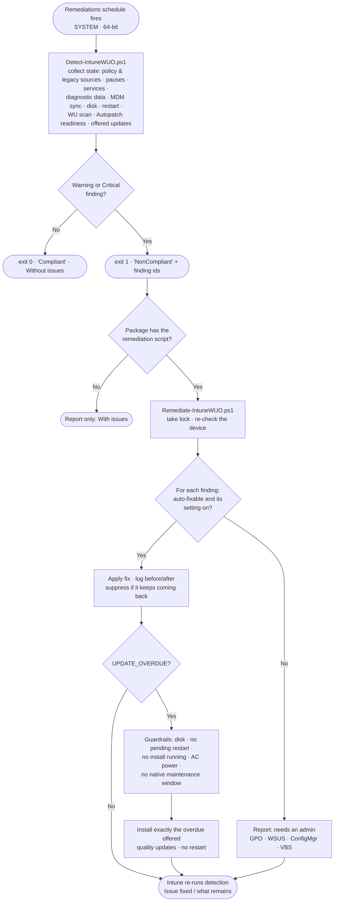
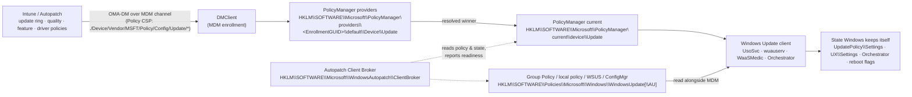

# Intune-WUO: Intune Windows Update Orchestration Platform

**A self-healing layer for Windows Update on Intune-managed devices, delivered as one standard Intune Remediations package.** Intune-WUO works alongside [Windows Autopatch](https://learn.microsoft.com/windows/deployment/windows-autopatch/overview/windows-autopatch-overview). It finds the device-side problems that stop Autopatch-approved updates from installing, fixes the safe ones automatically, and installs an approved quality update that is overdue. Results go back to Intune and to local logs.

**Two files, nothing to install:** [`remediation/Detect-IntuneWUO.ps1`](remediation/Detect-IntuneWUO.ps1) and [`remediation/Remediate-IntuneWUO.ps1`](remediation/Remediate-IntuneWUO.ps1). Upload them as a custom script package in **Devices › Scripts and remediations**. That's the whole deployment.

> [!IMPORTANT]
> **Project status: pre-release (v0.3).** The engine is covered by 119 Pester and 39 Node tests, and its fixes passed an end-to-end validation run on a Windows 11 test device enrolled in Autopatch. The standalone detection script runs on Windows 11 and is in its first tenant pilot. **Not yet proven:** a real update install by the remediation, detection as SYSTEM through Intune at scale, hotpatch enrollment detection, and a 24H2/25H2 device. Start with the detection script only, on a pilot group.

---

## Contents

- [Why Intune-WUO exists](#why-intune-wuo-exists)
- [What it does](#what-it-does)
- [Quick start](#quick-start)
- [Deploy with an AI agent](#deploy-with-an-ai-agent)
- [How it fits with Windows Autopatch](#how-it-fits-with-windows-autopatch)
- [How a run works](#how-a-run-works)
- [What it checks and fixes](#what-it-checks-and-fixes)
- [Hotpatch](#hotpatch)
- [Settings](#settings)
- [Registry and CSP reference](#registry-and-csp-reference)
- [Prerequisites](#prerequisites)
- [Deployment guide](#deployment-guide)
- [Operating it](#operating-it)
- [Security model](#security-model)
- [Optional: the Win32 app edition](#optional-the-win32-app-edition)
- [Repository layout](#repository-layout)
- [Roadmap](#roadmap)

---

## Why Intune-WUO exists

Windows Autopatch decides **what** a device should install and **when**: rings, approvals, deadlines, hotpatch and feature updates. It doesn't fix the **device** when that device can't carry out the decision. Autopatch raises an alert, and someone has to go and fix the machine.

The devices that miss the monthly security update are rarely missing it because of policy. The usual causes are on the device itself:

- A leftover Group Policy or WSUS setting (`DoNotConnectToWindowsUpdateInternetLocations`, `UseWUServer`, DualScan) still points the device somewhere else.
- A ConfigMgr co-management workload still owns Windows Update.
- A pause is still set, or an update service (`wuauserv`, `UsoSvc`, `WaaSMedicSvc`, `wlidsvc`) has been disabled.
- Diagnostic data is set too low for Autopatch to manage or report on the device.
- MDM sync is stale, disk space is low, or a restart is stuck pending.
- The Windows Update stack is corrupted and every scan fails.

Each of these devices is an **open vulnerability window** and usually a **manual ticket**. These "long tail" devices are what keep a fleet below its compliance target. Autopatch's own target is 95% of devices on the latest quality update.

### Business value

| Outcome | How Intune-WUO delivers it |
|---|---|
| **A shorter exposure window** | Blockers are fixed within hours instead of waiting for an alert, a ticket and an engineer. |
| **Fewer tickets and less manual remediation** | Common causes are fixed automatically, safely and consistently, with a record of each fix. |
| **Better audit and compliance evidence** | Every device reports a structured status to Intune: what was found, what was fixed, and what still needs a person. That gives evidence for patch-compliance controls. |
| **Protects your Autopatch investment** | Works *with* Autopatch rings and approvals and never against them, so the rollout, safeguards and reporting stay intact. |
| **Shows where legacy configuration remains** | It names each conflict (GPO, WSUS remnant, ConfigMgr), so you can fix the source instead of the symptom. |
| **Low risk by design** | Starts as detection only. It never restarts devices, never shows UI, never picks update content, and you switch it off by unassigning one package. |

---

## What it does

Intune-WUO is a standard Intune Remediations script package:

1. **Detect** (`Detect-IntuneWUO.ps1`). On the schedule you choose, it reads the policy Intune actually applied (MDM PolicyManager) and compares it with Group Policy, WSUS and ConfigMgr state. It also checks services, pauses, diagnostic data, MDM sync, disk, pending restarts, the Windows Update scan history, Autopatch readiness, hotpatch eligibility, and whether an approved quality update is overdue. It prints one status line for the Intune report and exits 1 when the device has an issue.
2. **Remediate** (`Remediate-IntuneWUO.ps1`). Intune runs it only after detection exits 1, and only if you added it to the package. It fixes the safe, well-understood blockers: disabled services, user pauses, a stale sync, low disk, and an overdue approved quality update (installed without a restart). It reports what it shouldn't touch, such as GPO values, ConfigMgr, VBS and Autopatch configuration.
3. **Report.** The status line goes to the Intune Remediations report. Detailed JSON and CMTrace logs go to the IME logs folder (so they're included in *Collect diagnostics*), and events go to the `IntuneWUO` event log.

**You decide in Intune, not in a config file:**

| Package contains | What happens on a device with an issue |
|---|---|
| Detection script only | Reported as *With issues*, with the finding ids. Nothing is changed |
| Detection **and** remediation script | Fixed automatically, then detection runs again and Intune shows *Issue fixed* or what remains |
| Package unassigned | Nothing runs |

**What it never does:** restart a device, prompt the user, change update policy, register or remove update services, install drivers or feature updates, install anything Autopatch hasn't approved, or change VBS, Smart App Control or WDAC settings.

---

## Quick start

1. Download [`remediation/Detect-IntuneWUO.ps1`](remediation/Detect-IntuneWUO.ps1) (and, later, [`remediation/Remediate-IntuneWUO.ps1`](remediation/Remediate-IntuneWUO.ps1)).
2. In the Intune admin center go to **Devices › Scripts and remediations › Create**. Name it `Intune-WUO` and upload the detection script. Leave the remediation script empty for now.
3. Settings: **Run this script using the logged-on credentials = No**, **Enforce script signature check = No** (unless you sign the scripts), **Run script in 64-bit PowerShell = Yes**.
4. Assign it to a **pilot device group**, schedule **Hourly**, every 1–8 hours. Never assign it to all devices first.
5. Watch **Device status** (add the *Pre-remediation detection output* column). When you're happy with what it reports, edit the package and upload the remediation script.

---

## Deploy with an AI agent

Ask ChatGPT, Claude, Grok, Gemini, Copilot or any MCP-capable agent to plan and deploy Intune-WUO in plain language. The project ships an **MCP server** and a **skill** so the agent learns exactly how to do it, and never needs access it should not have.

```bash
# Claude Code: the server (stdio). Needs Node.js 22+
claude mcp add intune-wuo -- npx -y github:bmrepository/Intune-WUOP

# Claude Code: server + skill as a plugin
/plugin install intune-wuo --marketplace bmrepository/Intune-WUOP
```

Then ask: *"Use the Intune-WUO MCP server to help me deploy Intune-WUO to my tenant. My devices are in Windows Autopatch and I want a pilot group first."*

| | |
|---|---|
| **MCP server** | `npx -y github:bmrepository/Intune-WUOP`: prerequisites check, phased plan, Microsoft Graph request bodies, validation checklists, and a status-line interpreter. **Offline and read-only: it never contacts your tenant and holds no credentials.** |
| **Skill** | [`skills/intune-wuo-deploy/SKILL.md`](skills/intune-wuo-deploy/SKILL.md): the workflow, hard rules and Graph facts in one file |
| **Any other agent** | Point it at [`AGENTS.md`](AGENTS.md) and [`llms.txt`](llms.txt), or paste: *"Read https://raw.githubusercontent.com/bmrepository/Intune-WUOP/main/AGENTS.md and help me deploy Intune-WUO."* |
| **Remote clients (ChatGPT, Grok)** | `node mcp/server.mjs --http` behind HTTPS. See the guide. |
| **Executing changes** | Your agent's own tenant tool (for example a Microsoft Graph MCP server such as Lokka), or [`tools/Invoke-WUOGraphRequests.ps1`](tools/Invoke-WUOGraphRequests.ps1), which asks for confirmation on every request |

**The full guide is [docs/AI-AGENTS.md](docs/AI-AGENTS.md)**: client configuration, how to connect an agent to your tenant with least privilege, example prompts, the exact Graph calls for the standalone package, and a safety checklist.

> The server and the agent only *plan and generate*. Nothing reaches your tenant unless **you** (or your agent, after you approve each batch) send it. Start every rollout with the detection script on a pilot group.

---

## How it fits with Windows Autopatch

| Responsibility | Windows Autopatch / Intune | Intune-WUO |
|---|---|---|
| Which updates are approved, and when | ✅ | ❌ never |
| Rings, deferrals, deadlines, grace periods | ✅ | reads them only |
| Hotpatch enrollment, feature and driver rollout | ✅ | reports blockers only |
| Restarts | ✅ native deadline and grace logic | ❌ never |
| Detecting device-side blockers | alerts (some need the optional Client Broker) | ✅ detailed, on your schedule |
| **Fixing** device-side blockers | ❌ | ✅ within guardrails, when the remediation script is in the package |
| Installing an approved quality update that is overdue | ❌ | ✅ after the ring deadline plus a grace period |
| Fleet reporting | ✅ Autopatch reports | ✅ per-device status in Intune Remediations |

---

## How a run works



Detection is read-only apart from one thing: it records, in `HKLM\SOFTWARE\IntuneWUO\State`, the date it first saw each offered update, which is how "overdue" is measured when Windows Update doesn't supply a deployment date.

---

## What it checks and fixes

| Area | Check | Action when the remediation script runs |
|---|---|---|
| **Policy conflicts** | The values Autopatch flags (`DoNotConnectToWindowsUpdateInternetLocations`, `DisableWindowsUpdateAccess`, `AU\NoAutoUpdate`) in the Group Policy keys | **Report** only: the source (domain GPO vs local policy) is not attributed yet, so nothing is removed |
| **WSUS remnants** | `UseWUServer` / `WUServer` / `UpdateServiceUrl`, DualScan | **Report** |
| **ConfigMgr** | ConfigMgr client present | **Report** only |
| **Pauses** | User pause (not set by policy) | **Fix** (`FixPauses`). A pause Intune is actively setting is never touched |
| **Services** | `wuauserv`, `UsoSvc`, `BITS`, `WaaSMedicSvc`, `wlidsvc`, `DiagTrack` set to *Disabled* (stopped trigger-start services are healthy and not flagged) | **Fix** (`FixServices`): restore the default start type |
| **Update stack** | No successful scan in `ScanStaleDays` | **Fix only if `FixResetStack` = 1** (off by default): reset components, at most once per `ResetCooldownDays`. **Side effect: this renames `SoftwareDistribution`, which also resets the Windows Update history list in Settings (installed updates stay installed).** Only the newest backup is kept |
| **Overdue update** | An approved quality or security update offered for longer than the ring deadline (`ConfigureDeadlineForQualityUpdates`, default 7) + `FallbackGraceDays` | **Fix** (`InstallOverdueUpdates`): install exactly those updates through the native Windows Update API. No drivers, no feature updates, never a restart; stops after `FallbackMaxAttempts` failures |
| **Diagnostic data** | At least *Required* (needed by Autopatch) | **Report** |
| **MDM sync** | Last sync older than `SyncStaleHours` | **Fix** (`FixSyncAndCleanup`): trigger a sync |
| **Disk** | Free space below `MinFreeDiskGB` | **Fix** (`FixSyncAndCleanup`): clean old temp files and run component cleanup. Also blocks update installs |
| **Restart** | A restart is pending | **Report** (left to the native deadline) |
| **Autopatch readiness** | The Autopatch Client Broker's latest `ResultsBitmask`/`ErrorCodes` and how recent its readiness timestamp is (see the [registry reference](#5-windows-autopatch-on-the-device)) | **Report** (`AUTOPATCH_READINESS_FAILED`, `AUTOPATCH_READINESS_STALE`; the ring is included in the status line). A missing broker is informational only |

The full catalogue, with each finding's cause and the admin action, is in [docs/findings.json](docs/findings.json).

---

## Hotpatch

Hotpatch installs monthly security updates **without a restart** on eligible devices. Intune-WUO handles it like this:

- **Eligibility is checked and reported**: Windows 11 24H2 or later (26H1 has no hotpatch), VBS running, CHPE disabled on Arm64.
- **The update install takes what's offered.** In a hotpatch month that's the hotpatch, with no restart. In a baseline month it's the LCU, and the restart is left to Windows.
- **Hotpatch findings implemented today:** `HOTPATCH_UNSUPPORTED_OS`, `HOTPATCH_VBS_NOT_RUNNING`, `HOTPATCH_CHPE_ENABLED`. They are raised only when hotpatch enrollment is known, and reading enrollment is not implemented yet, so they are currently dormant. Planned: `HOTPATCH_NOT_ENROLLED`, `HOTPATCH_OFF_BASELINE`, `HOTPATCH_FELL_BACK_TO_LCU`.
- VBS and CHPE are **never changed** by the tool. Each finding names the Intune policy that fixes it (the `VirtualizationBasedTechnology` CSP, the `DisableCHPE` CSP).

---

## Settings

Each script starts with a short settings block. Edit it before uploading, and **keep the same values in both scripts** (detection uses the thresholds too). `1` = on, `0` = off.

| Setting | Default | Meaning |
|---|---|---|
| `FixServices` | `1` | Re-enable disabled update services |
| `FixPauses` | `1` | Clear update pauses set by a user (never a policy pause) |
| `FixSyncAndCleanup` | `1` | Start an Intune sync when the last one is stale; clean up when disk space is low |
| `InstallOverdueUpdates` | `1` | Install approved quality updates that are overdue |
| `FixResetStack` | `0` | Reset the update stack when scans keep failing (wipes the Windows Update history list) |
| `FallbackGraceDays` | `3` | Days after the ring deadline before an offered update counts as overdue |
| `FallbackMaxAttempts` | `3` | Failed install attempts per update before giving up on it |
| `MinFreeDiskGB` | `20` | Below this, report `DISK_LOW` and don't install |
| `ResetCooldownDays` | `7` | Minimum days between update-stack resets |
| `SyncStaleHours` | `24` | Hours without an Intune sync before `SYNC_STALE` |
| `ScanStaleDays` | `7` | Days without a successful scan before `SCAN_STALE` |
| `FixMaxRepeats` | `3` | A fix needed this many times in 7 days is suppressed and reported (something else keeps undoing it) |

Invalid values fall back to the default and are logged as a warning. `HKLM\SOFTWARE\IntuneWUO\State` is owned by the scripts (first-seen dates, attempt counters, fix history). Don't edit it.

To change the settings in the source instead, edit [`src/Standalone/Settings.ps1`](src/Standalone/Settings.ps1) and run `.\build\Build-RemediationScripts.ps1`.

---

## Registry and CSP reference

Every registry location that takes part in orchestrating Windows Update on an Intune-managed device. Each entry is marked **(docs)** when Microsoft documents it, or **(observed)** when it was seen on a real Autopatch-enrolled Windows 11 test device but is not published. Observed locations can change between Windows builds, so Intune-WUO only ever *reads* them.

### 1. How a setting travels from Intune to the registry

<p align="center">
  <picture>
    <source media="(prefers-color-scheme: dark)" srcset="docs/images/policy-to-registry-dark.svg">
    
  </picture>
</p>

<details>
<summary>Interactive version (Mermaid)</summary>



</details>

Key points:

- **Update rings and Windows Update for Business settings reach the device over the MDM channel (Policy CSP), not through the Intune Management Extension.** The IME only delivers scripts, Win32 apps and Remediations, which is how Intune-WUO itself gets onto the device.
- The MDM policy engine stores what it received per provider, then publishes the **winning** value under `current\device`. **(docs for the default path; observed for the provider and `current` layout)**
- Group Policy and the MDM store are separate. When both set the same thing, Windows applies its own precedence, which is why leftover GPO or WSUS values are the most common cause of "policy not effective". On Windows 11 24H2 builds with KB5101684 (26100.8973) and later, the `IgnoreWindowsUpdateGroupPolicies` MDM policy makes Windows ignore Windows Update Group Policy entirely. **(docs)**

### 2. MDM (Intune) policy store

| Location | What it holds |
|---|---|
| `HKLM\SOFTWARE\Microsoft\PolicyManager\default\Update` **(docs)** | OS defaults and the schema of MDM-managed Update settings |
| `HKLM\SOFTWARE\Microsoft\PolicyManager\providers\<EnrollmentGUID>\default\Device\Update` **(observed)** | Values received from the MDM server, per enrollment, with a `<Setting>_LastWrite` marker beside each. `<EnrollmentGUID>` matches `Enrollments\<GUID>` below. For a user-scope policy the path is `...\default\<UserSID>\...` |
| `HKLM\SOFTWARE\Microsoft\PolicyManager\current\device\Update` **(observed)** | The resolved value Windows uses, plus `<Setting>_ProviderSet` (1 = a provider set it) and `<Setting>_WinningProvider` (the enrollment GUID). **This is the key Intune-WUO and the Autopatch broker read** |
| `HKLM\SOFTWARE\Microsoft\PolicyManager\current\device\System` **(observed)** | System policies that affect updates, notably `AllowTelemetry` (diagnostic data level) and `AllowBuildPreview` |
| `HKLM\SOFTWARE\Microsoft\PolicyManager\current\device\ControlPolicyConflict` **(observed)** | Conflict handling between MDM and Group Policy |
| `HKLM\SOFTWARE\Microsoft\Enrollments\<EnrollmentGUID>` **(docs)** | The MDM enrollment itself. `ProviderID` = `MS DM Server` for Intune; `FirstSync` holds first-sync / ESP status |
| Task Scheduler `\Microsoft\Windows\EnterpriseMgmt\<EnrollmentGUID>\` **(docs)** | The sync tasks the DMClient runs: `PushLaunch`, `PushRenewal`, `Login Schedule created by enrollment client`, and the schedule tasks. Their last-run times show when the device last synced |

### 3. Policy CSP – Update: setting → registry

CSP root: `./Device/Vendor/MSFT/Policy/Config/Update/<Setting>`. Each MDM setting appears under `PolicyManager\current\device\Update\<Setting>`. The Group Policy equivalent is under `HKLM\SOFTWARE\Policies\Microsoft\Windows\WindowsUpdate` unless stated. Only settings relevant to orchestration are listed; the full list is in the [Policy CSP – Update](https://learn.microsoft.com/windows/client-management/mdm/policy-csp-update) reference.

**Deferrals, pauses and targeting** **(docs)**

| CSP setting | Values | GPO registry value |
|---|---|---|
| `DeferQualityUpdatesPeriodInDays` | 0-30 days | `DeferQualityUpdatesPeriodinDays` (+ `DeferQualityUpdates`=1) |
| `DeferFeatureUpdatesPeriodInDays` | 0-365 days | `DeferFeatureUpdatesPeriodinDays` (+ `DeferFeatureUpdates`=1) |
| `PauseQualityUpdates` / `PauseQualityUpdatesStartTime` | 1 = paused; start date `yyyy-mm-dd`. A policy pause lasts 35 days from the start date | `PauseQualityUpdatesStartTime` |
| `PauseFeatureUpdates` / `PauseFeatureUpdatesStartTime` | same, for feature updates | `PauseFeatureUpdatesStartTime` |
| `SetDisablePauseUXAccess` | 1 = remove the user's *Pause updates* control | `SetDisablePauseUXAccess` |
| `SetDisableUXWUAccess` | 1 = remove the user's *Check for updates* control | `SetDisableUXWUAccess` |
| `BranchReadinessLevel` | channel selector. The CSP page lists 16 = Semi-Annual Enterprise Channel (1903 and later); the client-policy page lists 32 for General Availability | `BranchReadinessLevel` |
| `ProductVersion` + `TargetReleaseVersion` | target OS product and version (both needed) | `ProductVersion`, `TargetReleaseVersion` |
| `ExcludeWUDriversInQualityUpdate` | 1 = no drivers with quality updates | `ExcludeWUDriversInQualityUpdate` |
| `AllowOptionalContent` | 1-3 = receive optional updates / CFRs | `SetAllowOptionalContent` |
| `AllowMUUpdateService` | 1 = also scan Microsoft Update (other Microsoft products) | under `WindowsUpdate\AU` (part of *Configure Automatic Updates*) |
| `AllowTemporaryEnterpriseFeatureControl` | 1 = turn on features shipped in monthly updates | `AllowTemporaryEnterpriseFeatureControl` |
| `ManagePreviewBuilds` | Insider preview behaviour | `ManagePreviewBuilds` |
| `DisableWUfBSafeguards` | 1 = skip safeguard holds | per ADMX |

**Deadlines, restarts and installation behaviour** **(docs)**

| CSP setting | Values | Notes |
|---|---|---|
| `ConfigureDeadlineForQualityUpdates` / `...ForFeatureUpdates` | 0-30 days | When set, `AllowAutoUpdate` install/restart behaviour is ignored. **Intune-WUO uses the quality deadline as the base of its fallback timer** |
| `ConfigureDeadlineGracePeriod` / `...GracePeriodForFeatureUpdates` | 0-7 days | Minimum days from installation to automatic restart |
| `ConfigureDeadlineNoAutoReboot...` | 0/1 | Hold restarts until deadline and grace period have passed |
| `AllowAutoUpdate` | 0-5 (6 is written by the Intune *Reset to default* option **(observed)**) | GPO: `AU\AUOptions` / `AU\NoAutoUpdate` |
| `ScheduledInstallDay` / `...Time` / `...EveryWeek` / `...First-FourthWeek` | day 0-7, hour 0-23 | Only with `AllowAutoUpdate` 3 or 4. GPO: `AU\ScheduledInstall*` |
| `ActiveHoursStart` / `ActiveHoursEnd` / `ActiveHoursMaxRange` | hours 0-23; range 8-18 | GPO: `ActiveHoursStart`, `ActiveHoursEnd`, `SetActiveHours` |
| `UpdateNotificationLevel` / `NoUpdateNotificationsDuringActiveHours` | 0-2 / 0-1 | GPO: `SetUpdateNotificationLevel` |
| `SetEDURestart` | 0/1 | Education cart restarts |
| `AutomaticMaintenanceWakeUp` | 0/1 | GPO: `Policies\Microsoft\Windows\Task Scheduler\Maintenance\WakeUp` |
| `ConfigureFeatureUpdateUninstallPeriod` | 2-60 days | Rollback window |
| `AllowAutoWindowsUpdateDownloadOverMeteredNetwork` | 0/1 | |
| `AlwaysAutoRebootAtScheduledTimeMinutes`, `AutoRestart*`, `EngagedRestart*`, `Schedule*RestartWarning`, `SetAutoRestartNotificationDisable` | | **Legacy, not applicable to Windows 11**. Intune-WUO reports their presence as noise only |

**Native maintenance window** (Windows 11 24H2 with KB5077181, build 26100.7840 and later) **(docs)**: `MaintenanceWindowEnabled`, `MaintenanceWindowStartTime`, `MaintenanceWindowDurationHours` (2-24), `MaintenanceWindowRepeatScheduleOption` (1 none / 2 daily / 3 weekly / 4 monthly), `MaintenanceWindowStartDate`, `MaintenanceWindowUpdateActions` (1 download+install+restart / 2 install+restart / 3 restart only), the `MaintenanceWindowWeekly<Day>` flags and the `MaintenanceWindowMonthly*` settings. **When `MaintenanceWindowEnabled` = 1, Intune-WUO's fallback installer stays out of the way completely.**

**Update source (WSUS) and conflicts** **(docs)**

| CSP setting | GPO registry location | Why it matters |
|---|---|---|
| `UpdateServiceUrl`, `UpdateServiceUrlAlternate` | `WindowsUpdate\WUServer`, `WUStatusServer`, `UpdateServiceUrlAlternate` | Points the device at WSUS instead of Windows Update |
| *(GPO only)* | `WindowsUpdate\AU\UseWUServer` = 1 | Tells Automatic Updates to use that server |
| `SetPolicyDrivenUpdateSourceForQualityUpdates` / `...FeatureUpdates` / `...DriverUpdates` / `...OtherUpdates` | `WindowsUpdate\...` | 0 = Windows Update, **1 = WSUS (the default!)**. Only effective when a WSUS URL is set |
| `DisableDualScan` (legacy) | `WindowsUpdate\DisableDualScan` | With a WSUS URL, blocks scans against Windows Update, which blocks Autopatch |
| `DetectionFrequency` | under `WindowsUpdate\AU` | Only effective with a WSUS URL; 1-22 h |
| `IgnoreWindowsUpdateGroupPolicies` | n/a | **1 = ignore all Windows Update Group Policy.** The recommended tenant-wide fix for GPO conflicts (26100.8973 and later) |
| *(GPO only)* | `WindowsUpdate\DoNotConnectToWindowsUpdateInternetLocations` | **Autopatch flags this.** Blocks Windows Update, Store and Delivery Optimization |
| *(GPO only)* | `WindowsUpdate\DisableWindowsUpdateAccess` | **Autopatch flags this** |
| *(GPO only)* | `WindowsUpdate\AU\NoAutoUpdate` | **Autopatch flags this.** 1 = automatic updates off |

### 4. State that Windows maintains itself (read, never written by policy)

| Location | Values | Used by Intune-WUO |
|---|---|---|
| `HKLM\SOFTWARE\Microsoft\WindowsUpdate\UpdatePolicy\Settings` **(docs)** | `PausedQualityStatus`, `PausedFeatureStatus` (0 not paused, 1 paused, 2 auto-resumed); `PausedQualityDate`, `PausedFeatureDate` | Detects pauses. Never written |
| `HKLM\SOFTWARE\Microsoft\WindowsUpdate\UX\Settings` **(observed)** | User-facing state: `PauseQualityUpdatesStartTime/EndTime`, `PauseFeatureUpdatesStartTime/EndTime`, `PauseUpdatesStartTime`, `PauseUpdatesExpiryTime` (set when a user pauses in Settings), `ActiveHoursStart/End`, `IsExpedited`, `RestartNotificationsAllowed2`, `IsContinuousInnovationOptedIn` | **The `Pause*` values are what the pause fix removes** |
| `HKLM\SOFTWARE\Microsoft\WindowsUpdate\Orchestrator` **(docs)** | `\Configurations\UsoDisableAADJAttribution` (hide organisation name in notifications); `ScanBeforeInitialLogonAllowed` under `HKLM\SOFTWARE\Microsoft\Windows\CurrentVersion\WindowsUpdate\Orchestrator` (update before first sign-in) | Reported only |
| `HKLM\SOFTWARE\Microsoft\Windows\CurrentVersion\Component Based Servicing\RebootPending` **(observed)** | Key exists = servicing restart pending | `RESTART_PENDING` |
| `HKLM\SOFTWARE\Microsoft\WindowsUpdate\Auto Update\RebootRequired` **(observed)** | Key exists = Windows Update restart pending | `RESTART_PENDING` |
| `HKLM\SYSTEM\CurrentControlSet\Control\Session Manager` → `PendingFileRenameOperations` | Set on many healthy devices | **Deliberately ignored** |
| `HKLM\SYSTEM\CurrentControlSet\Control\Session Manager\Memory Management` → `HotPatchRestrictions` **(docs)** | 1 = CHPE disabled (Arm64 hotpatch requirement) | `HOTPATCH_CHPE_ENABLED` |
| `HKLM\SOFTWARE\Policies\Microsoft\Windows\DataCollection` and `PolicyManager\current\device\System` → `AllowTelemetry` **(docs)** | 0 off, 1 Required, 2 Enhanced/3 Optional | `DIAGDATA_LOW` (Autopatch needs Required or higher) |
| `HKLM\SOFTWARE\Microsoft\Windows NT\CurrentVersion` **(docs)** | `CurrentBuild`, `UBR`, `DisplayVersion`, `EditionID` | Build / edition checks |
| WMI `root\Microsoft\Windows\DeviceGuard\Win32_DeviceGuard` **(docs)** | `VirtualizationBasedSecurityStatus` (2 = running), code-integrity enforcement | Hotpatch VBS check; WDAC detection |

### 5. Windows Autopatch on the device

| Location | What it is |
|---|---|
| `HKLM\SOFTWARE\Microsoft\WindowsAutopatch\ClientBroker` **(observed)** | Written by the **Windows Autopatch Client Broker**. `Ring` (for example `Test`), `DeviceReadiness` (JSON results per check), `DeviceReadinessTimestamp` (Unix seconds). It also holds a signed access link (`ActionsFeedUri`); **Intune-WUO never reads that value** and you should not paste it into tickets or logs |
| `C:\ProgramData\Microsoft\AutopatchClientBroker\Logs\ClientBroker.log` **(observed)** | CMTrace-format broker log. The line `Completed RunDeviceReadinessChecks. ResultsBitmask=<n>, ErrorCodes=<...>` is the readiness verdict (0 = all pass). **Intune-WUO reads the latest such line** (`AUTOPATCH_READINESS_FAILED`) |
| `C:\Program Files\Windows Autopatch Client Broker\` **(observed)** | Broker binaries (installed as a Win32 app via the *Manage client broker* tenant setting) |
| `%ProgramData%\Microsoft\CMDExtension\Plugins\DeviceReadinessPlugin\Logs\DRCResults.json.log` **(docs, older agent)** | Where Microsoft's documentation says readiness results are written. Newer brokers log to the path above instead |

The broker's own log lists the registry keys Autopatch evaluates, which is a useful map of what *Autopatch itself* treats as relevant **(observed)**: `PolicyManager\current\device\Update`, `Policies\Microsoft\Windows\WindowsUpdate` and `\AU`, `WindowsUpdate\UpdatePolicy\Settings`, the Appraiser and compatibility markers under `Windows NT\CurrentVersion\AppCompatFlags\{Appraiser\RunResults\LastRun, CompatMarkers\*, TargetVersionUpgradeExperienceIndicators\*}`, `CurrentVersion\SideBySide\CorruptionFlags`, `CurrentVersion\WindowsUpdate\OSUpgrade\Rollback`, Microsoft 365 Apps `ClickToRun\Configuration` and `Policies\...\officeupdate`, and `Policies\Microsoft\EdgeUpdate`.

### 6. Other agents that touch the same settings

| Location | Meaning |
|---|---|
| `HKLM\SOFTWARE\Microsoft\CCM`, `C:\Windows\ccmsetup` **(observed)** | ConfigMgr client present. On co-managed devices the *Windows Update policies* workload must be set to Intune, and ConfigMgr client Software Updates settings must not be configured |
| `C:\ProgramData\Microsoft\IntuneManagementExtension\Logs\` **(docs)** | IME logs (`IntuneManagementExtension.log`, `AgentExecutor.log`, `AppWorkload.log`, `HealthScripts.log`). Remediation runs are in `HealthScripts.log`. Intune-WUO writes its own logs in an `IntuneWUO` subfolder here so *Collect diagnostics* picks them up |
| `HKLM\SOFTWARE\Microsoft\IntuneManagementExtension` **(observed)** | IME state |

### 7. What Intune-WUO reads and writes

| Location | Access |
|---|---|
| `PolicyManager\current\device\Update` and `...\System` | **Read** |
| `Policies\Microsoft\Windows\WindowsUpdate`, `\AU`, `\DataCollection` | **Read** (never modified; policy-key fixes are not enabled) |
| `WindowsUpdate\UpdatePolicy\Settings`, `Component Based Servicing\RebootPending`, `Auto Update\RebootRequired`, `Memory Management`, `WindowsAutopatch\ClientBroker` (not `ActionsFeedUri`), the Autopatch `ClientBroker.log` | **Read** |
| `WindowsUpdate\UX\Settings` → the `Pause*` user-pause values | **Write (remove)**, only the pause fix, only when `FixPauses` = 1 and the pause was not set by policy |
| Service start types for `wuauserv`, `UsoSvc`, `BITS`, `WaaSMedicSvc`, `wlidsvc`, `DiagTrack` | **Write**, only when the service is *Disabled* and `FixServices` = 1 |
| `SoftwareDistribution`, `catroot2` | **Rename**, only the update-stack reset, only when `FixResetStack` = 1 (off by default) |
| Windows Update API (default service) | **Scan** in detection and remediation; **install** only overdue approved quality updates, only when `InstallOverdueUpdates` = 1 and the remediation script runs |
| `HKLM\SOFTWARE\IntuneWUO\State` (first-seen dates, attempt and fix counters) | **Write** (tool-owned) |
| Event log `IntuneWUO`, `...\IntuneManagementExtension\Logs\IntuneWUO` | **Created** by the first run as SYSTEM |
| *Win32 edition only:* `HKLM\SOFTWARE\IntuneWUO` (Mode), task `\IntuneWUO\IntuneWUO-Fallback`, `%ProgramFiles%\IntuneWUO` | Created by the Win32 app |

### 8. Inspecting a device yourself

```powershell
# What Intune delivered, and which enrollment won
Get-ItemProperty 'HKLM:\SOFTWARE\Microsoft\PolicyManager\current\device\Update'

# Any Group Policy / WSUS / local-policy leftovers
Get-ItemProperty 'HKLM:\SOFTWARE\Policies\Microsoft\Windows\WindowsUpdate' -ErrorAction SilentlyContinue
Get-ItemProperty 'HKLM:\SOFTWARE\Policies\Microsoft\Windows\WindowsUpdate\AU' -ErrorAction SilentlyContinue

# Pause, reboot and Autopatch state (do not copy ActionsFeedUri anywhere)
Get-ItemProperty 'HKLM:\SOFTWARE\Microsoft\WindowsUpdate\UpdatePolicy\Settings'
Get-ItemProperty 'HKLM:\SOFTWARE\Microsoft\WindowsAutopatch\ClientBroker' | Select-Object Ring, DeviceReadinessTimestamp

# Latest Autopatch readiness verdict
Select-String -Path "$env:ProgramData\Microsoft\AutopatchClientBroker\Logs\ClientBroker.log" -Pattern 'Completed RunDeviceReadinessChecks' | Select-Object -Last 1

# When did the device last sync with Intune?
Get-ScheduledTask -TaskPath '\Microsoft\Windows\EnterpriseMgmt\*' | Get-ScheduledTaskInfo | Select-Object TaskName, LastRunTime

# Full MDM diagnostics bundle (admin): shows every applied policy and its source
mdmdiagnosticstool.exe -area "DeviceEnrollment;DeviceProvisioning;Autopilot" -zip C:\Temp\mdmdiag.zip
```

---

## Prerequisites

| Area | Requirement |
|---|---|
| **Licensing** | Windows Enterprise E3/E5 (or Microsoft 365 E3/E5/F3, A3/A5, VDA). **Remediations require it.** Business Premium includes Autopatch but not Remediations |
| **Management** | Devices enrolled in Intune and registered with **Windows Autopatch** (groups, quality approval policies). Entra joined or hybrid joined |
| **OS** | Windows 11 Enterprise or Education. 24H2 or later is recommended (needed for hotpatch and `IgnoreWindowsUpdateGroupPolicies`) |
| **PowerShell** | Windows PowerShell 5.1, 64-bit (inbox). Full language mode (the scripts load their engine as an in-memory module) |
| **Diagnostic data** | Required level or higher (an Autopatch prerequisite) |
| **Recommended tenant settings** | Install the **Autopatch Client Broker** (Tenant administration › Windows Autopatch › Tenant management › Manage client broker), so Intune-WUO can read Autopatch's readiness results on the device. On builds that support it, deploy **`Update/IgnoreWindowsUpdateGroupPolicies = 1`**, so that leftover Group Policy no longer overrides MDM |
| **Code signing** *(optional)* | Sign both scripts with a certificate the devices trust if you want *Enforce script signature check* on |

---

## Deployment guide

### Step 1: Prepare the tenant

1. **Record a baseline.** Export the Autopatch quality-update and *Autopatch management status* reports, and note the count of *Not ready* and alerted devices. Success is measured against these.
2. **Create a pilot device group**, for example `SG-IntuneWUO-Pilot` with assigned membership, holding 10–20 IT devices. Reuse your **Autopatch ring groups** (Test, First, Fast, Broad) for the later rollout, and keep an exclusion group for servers, kiosks, shared devices, multi-session/AVD, Windows 365 and LTSC.
3. **Turn on the recommended settings** above: the Client Broker, `IgnoreWindowsUpdateGroupPolicies`, and diagnostic data at Required.

### Step 2: Create the package (detection only)

**Devices › Scripts and remediations › Create**:

| Setting | Value |
|---|---|
| Name | `Intune-WUO` |
| Detection script file | `remediation/Detect-IntuneWUO.ps1` |
| Remediation script file | *(leave empty for now)* |
| Run this script using the logged-on credentials | **No** (it runs as SYSTEM) |
| Enforce script signature check | **No**, or **Yes** if you signed the scripts |
| Run script in 64-bit PowerShell | **Yes** (required: registry views) |
| Assignment | The pilot group only. Exclude your exclusion group |
| Schedule | **Hourly**: every 1 hour while you're piloting, then every 8 hours |

The Intune Management Extension fetches new script packages every 8 hours or when it restarts, so the first result can take up to 8 hours. **Run remediation** on a device's page in the admin center starts a run straight away.

### Step 3: Read the results

Open the package's **Device status** and add the *Pre-remediation detection output* column, or **Export** it to CSV. Each device reports one line, for example:

```text
WUO|v1|NonCompliant|Mode=Script|Build=26100|Ring=Test|F=SVC_DISABLED_wuauserv,PAUSE_QUALITY_USER
```

`Compliant` / `NonCompliant` is the verdict, `Ring` is the Autopatch ring the Client Broker reports, and `F=` lists the finding ids, most severe first. Look each one up in [docs/findings.json](docs/findings.json) (or ask the MCP server's `wuo_interpret_status`).

### Step 4: Turn on fixes

Edit the package, upload `remediation/Remediate-IntuneWUO.ps1` as the remediation script, and save. From the next run, devices with a fixable issue are fixed and detection runs again. Intune then shows *Issue fixed* or the issue that remains (usually a report-only finding that needs an admin).

### Step 5: Roll out

| Stage | Groups | Package | Move on when |
|---|---|---|---|
| 1. Pilot | Pilot group | Detection only → **with remediation** | 1–2 Patch Tuesday cycles with no fix-related incidents |
| 2. Rings | Autopatch Test → First → Fast → Broad, one cycle apart | With remediation | Each ring has a clean cycle |

To pilot fixes on fewer devices than you report on, create a second package (`Intune-WUO-Remediate`, both scripts) for a smaller group and keep the detection-only package on the rest. Don't assign both packages to the same device.

### Step 6: Verify on a device

```powershell
Get-ChildItem 'C:\ProgramData\Microsoft\IntuneManagementExtension\Logs\IntuneWUO'
Get-Content 'C:\ProgramData\Microsoft\IntuneManagementExtension\Logs\IntuneWUO\IntuneWUO.log' -Tail 20
Get-WinEvent -LogName IntuneWUO -MaxEvents 20
Get-ItemProperty 'HKLM:\SOFTWARE\IntuneWUO\State' -ErrorAction SilentlyContinue
```

The Intune Management Extension's own record of each run is in `...\IntuneManagementExtension\Logs\HealthScripts.log`.

---

## Operating it

### Where results go

| Destination | Contents |
|---|---|
| **Intune Remediations report** | Detection: `WUO\|v1\|<Compliant\|NonCompliant>\|Mode=Script\|Build=…\|Ring=…\|F=<ids>`. Remediation: `WUO\|v1\|Remediated\|Fixed=…\|Failed=…\|Suppressed=…\|AdminAction=<report-only ids>`. Both stay under Intune's 2,048-character limit |
| **`…\IntuneManagementExtension\Logs\IntuneWUO\`** | `IntuneWUO.jsonl` (machine-readable, includes every finding's message and each update-install decision) and `IntuneWUO.log` (CMTrace), rotated by size. Collected by *Collect diagnostics* |
| **Event Log `IntuneWUO`** | Fixed event IDs per finding and action, for Event Viewer, Defender XDR or SIEM forwarding. Created by the first run as SYSTEM |

**Event IDs:**

| ID | Meaning |
|---|---|
| `1001` | Detection run complete |
| `2000–2099` | A finding. Each known finding has a fixed id (see [docs/DESIGN.md](docs/DESIGN.md)); unknown ones use `2099` |
| `3000–3099` | The matching fix was applied (finding id + 1000) |
| `3500–3599` | The matching fix failed (finding id + 1500) |
| `4001` | Overdue updates installed |
| `4002` | Update install failed |
| `4003` | Update install blocked by a guardrail |
| `9000` | Error |

### Troubleshooting

| Symptom | Where to look |
|---|---|
| No results after hours | The Intune Management Extension hasn't fetched the package yet (every 8 hours, or on restart). Use **Run remediation**, or check `HealthScripts.log` on the device |
| Output starts with `WUO\|v1\|Error\|` | The script itself failed; the message follows. Detection then exits 0 so it never triggers a fix |
| A fix keeps being reported as `Suppressed` | Something keeps undoing it (often a GPO or a ConfigMgr setting). Fix the source, or deploy `IgnoreWindowsUpdateGroupPolicies` |
| `UPDATE_OVERDUE` stays after remediation | Check the `4003` guardrail event (restart pending, low disk, on battery, install running, native maintenance window) or the `4002` HResult |

### Stop or remove

- **Stop fixes, keep reporting:** edit the package and remove the remediation script.
- **Stop everything:** unassign or delete the package.
- **Nothing to revert:** Intune-WUO never changes Intune or Autopatch policy. On a device, `HKLM\SOFTWARE\IntuneWUO`, the `IntuneWUO` event log and the log folder can be deleted.

---

## Security model

- **Least surprise.** No restarts, no UI, no policy writes, no service-manager changes, and no installs of content Autopatch hasn't approved.
- **Nothing downloaded at runtime.** The scripts are self-contained and only talk to the local Windows Update API (default service).
- **Reviewable.** Each script is a single readable file generated from the tested module; a test fails if the committed file differs from what the source generates.
- **No secrets on devices.** v1 sends no data to external endpoints.
- **Guardrails on every fix.** GPO and ConfigMgr values are never deleted. An active Intune pause is never cleared. A fix that keeps being undone stops being re-applied. Every change is logged with its before/after state.

---

## Optional: the Win32 app edition

The first design shipped the engine as a Win32 app with a registry-based mode switch (`HKLM\SOFTWARE\IntuneWUO\Mode` = `Off` / `ReportOnly` / `Remediate` / `RemediateAndFallback`), one config package per mode, a pinned PSWindowsUpdate backend and a daily fallback scheduled task. That code is still in the repository (`src/Win32`, `src/Config`, `src/Remediation`, `build/Build-IntuneWUO.ps1`) and passed its end-to-end validation, but **it is not the recommended deployment**: the standalone package does the same work with no app, no registry mode and no scheduled task. Its design is described in [docs/DESIGN.md](docs/DESIGN.md), and the MCP server's `wuo_win32_app_reference` tool still explains it.

---

## Repository layout

```text
remediation/            Detect-IntuneWUO.ps1, Remediate-IntuneWUO.ps1: the files you upload (generated)
src/
  IntuneWUO/            Engine module: config, state, findings, fixes, update install, logging
  Standalone/           Templates and the settings block for the two remediation scripts
  Remediation/, Config/, Win32/   The optional Win32 app edition
tests/                  Pester tests (mocked registry, services, backend and update API)
build/                  Build-RemediationScripts.ps1 (the two scripts); Build-IntuneWUO.ps1 (Win32 edition)
tools/                  Invoke-WUOValidation.ps1, Invoke-WUOGraphRequests.ps1, New-DiagramImages.ps1
mcp/                    MCP server for AI agents (Node): server.mjs, src/, test/
skills/                 intune-wuo-deploy/SKILL.md (agent skill)
.claude-plugin/         Claude Code plugin + marketplace manifests (skill + MCP server)
AGENTS.md, llms.txt, .mcp.json, package.json   Agent entry points and the npm package for the MCP server
docs/
  DESIGN.md             Design: finding catalogue, guardrails, schemas, event IDs
  AI-AGENTS.md          Deploy with an AI agent: client setup, tenant connection, safety
  findings.json         Machine-readable findings catalogue (used by the MCP server)
  images/               SVG diagrams (light and dark) of the Win32 edition
```

### Changing the code

Edit the module under `src/IntuneWUO` or the templates under `src/Standalone`, then regenerate the two scripts:

```powershell
.\build\Build-RemediationScripts.ps1
```

PowerShell that Intune runs must stay ASCII only, UTF-8 without BOM, and Windows PowerShell 5.1 compatible; the build checks all three.

### Running the tests

```powershell
Install-Module Pester -Scope CurrentUser   # Pester 5 or later
Invoke-Pester -Path .\tests -Output Detailed

# MCP server (Node 22+)
npm install
npm test
```

### Validating on a real device

`tools\Invoke-WUOValidation.ps1` is an end-to-end check of the engine's fixes on a **test device**. It currently drives the Win32 edition: it elevates itself (one UAC prompt), installs the package, exercises every mode, the service and pause fixes, the MDM sync trigger, the update-install guardrails, the task self-heal and uninstall, and restores everything it touched. It never installs a Windows update.

```powershell
.\tools\Invoke-WUOValidation.ps1                    # safe checks
.\tools\Invoke-WUOValidation.ps1 -IncludeDisruptive # also runs DISM component cleanup and the update-stack reset
```

**"Running scripts is disabled on this system"?** That is Windows' default execution policy blocking unsigned scripts, and it applies to every `.ps1` in this repository. Do not weaken the machine-wide policy. Allow it for the current window only (nothing is changed on disk), then run the script as above:

```powershell
Set-ExecutionPolicy -Scope Process -ExecutionPolicy Bypass
# or, in one line, without changing any policy:
powershell.exe -NoProfile -ExecutionPolicy Bypass -File .\tools\Invoke-WUOValidation.ps1
```

If the files came from a ZIP download, also run `Get-ChildItem -Recurse .\ | Unblock-File` once. Intune runs Remediations with its own policy settings, so this doesn't affect devices.

Results are written to `local\validation\<host>-<timestamp>.md` and `.json`. That folder is git-ignored on purpose: the reports contain machine details, so they are never committed.

---

## Roadmap

- [x] Requirements agreed (role, delivery, Autopatch setup, legacy sources, fix scope, restarts, control, engine, schedule, logging, success measures, rollout, hotpatch)
- [x] Read-only discovery on a first Windows 11 test device
- [x] `docs/DESIGN.md`
- [x] Engine with Pester tests: detection, fixes (services, user pauses, stale sync, low disk, update-stack reset), each behind its own switch
- [x] Update installer with guardrails (native WUA, no restart, no drivers or feature updates)
- [x] End-to-end validation of the fixes on a real Windows 11 test device (two bugs found and fixed with regression tests)
- [x] Read the Autopatch Client Broker readiness result, ring and timestamp
- [x] MCP server, skill, Claude Code plugin and agent guide (offline, read-only; tenant writes stay with the agent's own tool after human approval)
- [x] **Standalone Remediations package**: two self-contained scripts, Intune decides report vs fix, overdue-update install in the remediation, stack reset off by default
- [x] Package created through Microsoft Graph in a test tenant (detection only, pilot group)
- [ ] First detection results from the pilot devices in Intune, then turn on the remediation script
- [ ] A real overdue-update install by the remediation script on a test device
- [ ] Validation on a 24H2/25H2 device (hybrid-joined or co-managed)
- [ ] Tiered stack reset that preserves the Windows Update history (clear `SoftwareDistribution\Download` first; full rename only if scans stay stale)
- [ ] Attribute policy values to domain GPO vs local policy (would allow removing local leftovers; today policy findings are report-only)
- [ ] Hotpatch enrollment detection (hotpatch findings stay skipped until then)
- [ ] Update the MCP server, skill and validation harness to the standalone package (they still describe the Win32 edition)

## License

See [LICENSE](LICENSE).
