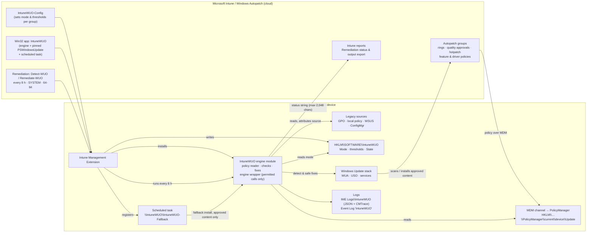
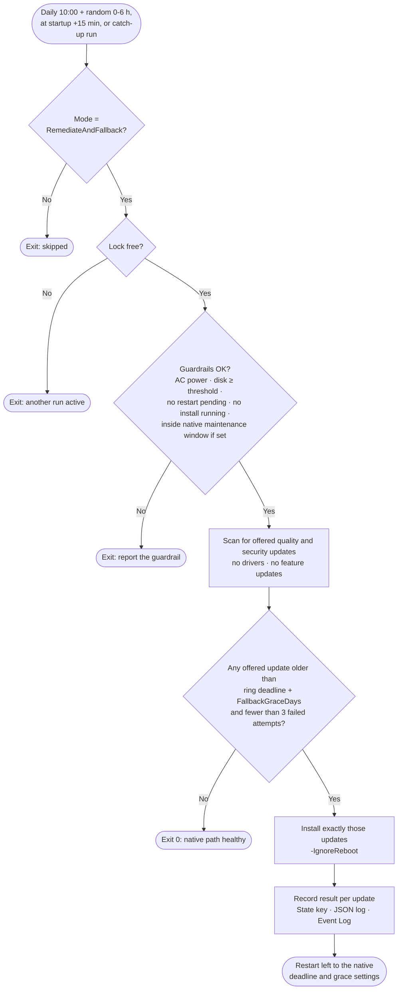

# Intune-WUO: Intune Windows Update Orchestration Platform

**A self-healing layer for Windows Update on Intune-managed devices.** Intune-WUO works alongside [Windows Autopatch](https://learn.microsoft.com/windows/deployment/windows-autopatch/overview/windows-autopatch-overview). It finds the device-side problems that stop Autopatch-approved updates from installing, fixes the safe ones automatically, and, as a last resort, installs the overdue approved update itself. Results go back to Intune and to local logs.

> [!IMPORTANT]
> **Project status: design phase.** The requirements are agreed and the first device discovery is done. The components, switches and deployment steps below describe the **target design**. No scripts or packages exist yet. See [Roadmap](#roadmap).

---

## Contents

- [Why Intune-WUO exists](#why-intune-wuo-exists)
- [What it does](#what-it-does)
- [How it fits with Windows Autopatch](#how-it-fits-with-windows-autopatch)
- [Architecture](#architecture)
- [How a run works](#how-a-run-works)
- [What it checks and fixes](#what-it-checks-and-fixes)
- [Hotpatch](#hotpatch)
- [Modes and switches](#modes-and-switches)
- [Prerequisites](#prerequisites)
- [Deployment guide](#deployment-guide)
- [Operating it](#operating-it)
- [Security model](#security-model)
- [Repository layout](#repository-layout)
- [Roadmap](#roadmap)

---

## Why Intune-WUO exists

Windows Autopatch decides **what** a device should install and **when**: rings, approvals, deadlines, hotpatch and feature updates. It doesn't fix the **device** when that device can't carry out the decision. Autopatch raises an alert, and someone has to go and fix the machine.

The devices that miss the monthly security update are rarely missing it because of policy. The usual causes are on the device itself:

- A leftover Group Policy or WSUS setting (`DoNotConnectToWindowsUpdateInternetLocations`, `UseWUServer`, DualScan) still points the device somewhere else.
- A ConfigMgr co-management workload still owns Windows Update.
- A pause is still set, or an update service (`wuauserv`, `UsoSvc`, `WaaSMedicSvc`, `wlidsvc`) has been disabled.
- Diagnostic data is set too low for Autopatch to manage or report on the device.
- MDM sync is stale, disk space is low, or a restart is stuck pending.
- The Windows Update stack is corrupted and every scan fails.

Each of these devices is an **open vulnerability window** and usually a **manual ticket**. These "long tail" devices are what keep a fleet below its compliance target. Autopatch's own target is 95% of devices on the latest quality update.

### Business value

| Outcome | How Intune-WUO delivers it |
|---|---|
| **A shorter exposure window** | Blockers are fixed within hours instead of waiting for an alert, a ticket and an engineer. |
| **Fewer tickets and less manual remediation** | Common causes are fixed automatically, safely and consistently, with a record of each fix. |
| **Better audit and compliance evidence** | Every device reports a structured status to Intune: what was found, what was fixed, and what still needs a person. That gives evidence for patch-compliance controls. |
| **Protects your Autopatch investment** | Works *with* Autopatch rings and approvals and never against them, so the rollout, safeguards and reporting stay intact. |
| **Shows where legacy configuration remains** | It names the source of each conflict (domain GPO, local policy, ConfigMgr, WSUS remnant), so you can fix the source instead of the symptom. |
| **Low risk by design** | Starts in report-only mode. It never restarts devices, never shows UI, never picks update content, and has a central kill switch. |

---

## What it does

Intune-WUO does four things:

1. **Detect.** Every 8 hours it reads the policy Intune actually applied (MDM PolicyManager) and compares it with Group Policy, WSUS and ConfigMgr state. It also checks services, pauses, diagnostic data, MDM sync, disk, pending restarts, the device's security controls, the Windows Update scan and install history, and hotpatch eligibility.
2. **Remediate.** It fixes the safe, well-understood blockers automatically: services, stray pauses, local or stray policy values, a stale sync, and low disk. It reports what it shouldn't touch, such as domain GPO values, ConfigMgr, VBS and Autopatch configuration.
3. **Fall back.** If a device *still* lacks an Autopatch-approved quality update after the ring deadline plus a grace period, a scheduled task installs exactly the updates Windows Update is offering that device. Restarts are suppressed and left to Windows.
4. **Report.** It sends a compact status to Intune through Remediation output, writes detailed JSON and CMTrace logs to the IME logs folder (so they're included in *Collect diagnostics*), and writes to its own Windows Event Log.

**What it never does:** restart a device, prompt the user, change update policy, register or remove update services, install drivers or feature updates, install anything Autopatch hasn't approved, or change VBS, Smart App Control or WDAC settings.

---

## How it fits with Windows Autopatch

| Responsibility | Windows Autopatch / Intune | Intune-WUO |
|---|---|---|
| Which updates are approved, and when | ✅ | ❌ never |
| Rings, deferrals, deadlines, grace periods | ✅ | reads them only |
| Hotpatch enrollment, feature and driver rollout | ✅ | reports blockers only |
| Restarts | ✅ native deadline and grace logic | ❌ never |
| Detecting device-side blockers | alerts (some need the optional Client Broker) | ✅ detailed, every 8 hours |
| **Fixing** device-side blockers | ❌ | ✅ within guardrails |
| Installing an overdue approved update when the native path keeps failing | ❌ | ✅ last-resort fallback |
| Fleet reporting | ✅ Autopatch reports | ✅ per-device status in Intune Remediations |

---

## Architecture



### Components

| Component | Delivered by | Runs as | Purpose |
|---|---|---|---|
| **IntuneWUO engine module** | Win32 app → `%ProgramFiles%\IntuneWUO` | — | Shared logic: config, logging, policy reader, checks, fixes, engine wrapper |
| **Pinned PSWindowsUpdate 2.2.1.5** | Inside the Win32 app, with a SHA-256 manifest | — | Main update backend behind a permitted-calls wrapper. Native WUA COM is the backup |
| **Detect-WUO.ps1 / Remediate-WUO.ps1** | Intune Remediations | SYSTEM, 64-bit | Detect every 8 hours. Fix when a blocker is found and the mode allows it |
| **IntuneWUO-Fallback scheduled task** | Registered by the Win32 app | SYSTEM | Install an overdue approved update, with restarts suppressed |
| **IntuneWUO-Config** | A small Remediation or Win32 app, per group | SYSTEM | Write the mode and thresholds to `HKLM\SOFTWARE\IntuneWUO` |

---

## How a run works

### Detect and remediate (every 8 hours)


### Fallback install (scheduled task)



---

## What it checks and fixes

| Area | Check | Default action in `Remediate` mode |
|---|---|---|
| **Policy conflicts** | The values Autopatch flags (`DoNotConnectToWindowsUpdateInternetLocations`, `DisableWindowsUpdateAccess`, `AU\NoAutoUpdate`), compared between PolicyManager and the GPO keys, with each value's source identified | **Fix** if the value comes from local policy or a stray write. **Report** if it comes from domain GPO or ConfigMgr |
| **WSUS remnants** | `UseWUServer` / `WUServer` / `UpdateServiceUrl`, the `SetPolicyDrivenUpdateSourceFor*` values, DualScan | Same rule as above |
| **ConfigMgr** | Co-management workloads for Windows Update and Device configuration, and the Software Updates client agent | **Report** only |
| **Pauses** | User pause, expired policy pause | **Fix**. A pause Intune is actively setting is never touched |
| **Services** | `wuauserv`, `UsoSvc`, `BITS`, `WaaSMedicSvc`, `wlidsvc`, `DiagTrack` compared with their *default* start types (trigger-start services are often stopped, and that's healthy) | **Fix** |
| **Update stack** | Scans failing again and again | **Fix**: reset components, at most once per `ResetCooldownDays` |
| **Diagnostic data** | At least *Required* (needed by Autopatch) | **Report** |
| **MDM sync** | Last sync older than `SyncStaleHours` | **Fix**: trigger a sync |
| **Disk** | Free space below `MinFreeDiskGB` | **Fix**: safe cleanup. **Report** if still low afterwards |
| **Restart** | Restart pending past its deadline. `PendingFileRenameOperations` alone doesn't count, because it's often set on healthy devices | **Report** |
| **Compliance** | On the latest approved LCU, or the current hotpatch on top of the current baseline | **Report**, and feeds the fallback |
| **Environment** | Language mode, WDAC/App Control, AppLocker, WinHTTP proxy, endpoint reachability | **Report** as capability flags. Also decides which update backend to use |
| **Autopatch readiness** | Reads `DRCResults.json.log` if the Autopatch Client Broker is installed | Merged into the findings |

---

## Hotpatch

Hotpatch installs monthly security updates **without a restart** on eligible devices. Intune-WUO handles it like this:

- **Eligibility is checked and reported**: Windows 11 24H2 or later (26H1 has no hotpatch), VBS running, CHPE disabled on Arm64, and the device on the latest baseline.
- **Baseline or hotpatch cycle** is worked out from what Windows Update offers and from install history, **never from a calendar**. Microsoft adds unplanned baseline months; June and September 2026 were baselines.
- **Hotpatch-aware compliance:** on a hotpatch device in a hotpatch month, the absence of a new LCU isn't a finding.
- **The fallback installs what's offered.** In a hotpatch month that's the hotpatch, with no restart. In a baseline month it's the LCU, and the restart is left to Windows.
- **Hotpatch findings:**
  - `HOTPATCH_NOT_ENROLLED`
  - `HOTPATCH_VBS_NOT_RUNNING`
  - `HOTPATCH_CHPE_ENABLED`
  - `HOTPATCH_OFF_BASELINE`
  - `HOTPATCH_FELL_BACK_TO_LCU`
  - `HOTPATCH_UNSUPPORTED_OS`
- VBS and CHPE are **never changed** by the tool. Each finding names the Intune policy that fixes it (the `VirtualizationBasedTechnology` CSP, the `DisableCHPE` CSP).

---

## Modes and switches

Everything is controlled centrally through registry values under **`HKLM\SOFTWARE\IntuneWUO`**, which an Intune assignment writes per group. **If a value is missing or invalid, the tool falls back to `ReportOnly`.**

### Modes

| `Mode` | Detect and report | Automatic fixes | Fallback install | Use it for |
|---|---|---|---|---|
| `Off` | ❌ | ❌ | ❌ | **Kill switch.** Everything stops at the next run |
| `ReportOnly` *(default)* | ✅ | ❌ | ❌ | First rollout and baseline measurement |
| `Remediate` | ✅ | ✅ | ❌ | Normal operation once a ring has had a clean ReportOnly cycle |
| `RemediateAndFallback` | ✅ | ✅ | ✅ | The full self-healing layer, enabled ring by ring last |

### Settings *(proposed; finalised in the design doc)*

| Value | Type | Default | Meaning |
|---|---|---|---|
| `Mode` | String | `ReportOnly` | See above |
| `FallbackGraceDays` | DWORD | `3` | Days after the ring's quality-update deadline before the fallback acts |
| `FallbackMaxAttempts` | DWORD | `3` | Failed attempts per update before the fallback stops trying and reports |
| `MinFreeDiskGB` | DWORD | `20` | Disk threshold for the cleanup fix and the fallback guardrail |
| `ResetCooldownDays` | DWORD | `7` | Minimum days between update-stack resets |
| `SyncStaleHours` | DWORD | `24` | MDM sync age that triggers a sync |
| `FixServices` | DWORD 0/1 | `1` | Allow service fixes |
| `FixPauses` | DWORD 0/1 | `1` | Allow pause fixes |
| `FixPolicyKeys` | DWORD 0/1 | `1` | Allow removal of local or stray policy values |
| `FixSyncAndCleanup` | DWORD 0/1 | `1` | Allow sync triggers and disk cleanup |

`HKLM\SOFTWARE\IntuneWUO\State` is owned by the tool: first-seen dates, attempt counters and write-back tracking. Don't edit it.

### Changing a mode or switch

The supported way is an **Intune assignment**, never manual edits on devices:

1. In **Devices › Scripts and remediations**, create (or edit) the **IntuneWUO-Config** script package. Its remediation script sets the values; its detection script checks them. A minimal example:

   ```powershell
   # IntuneWUO-Config remediation: example for a Remediate ring
   $key = 'HKLM:\SOFTWARE\IntuneWUO'
   New-Item -Path $key -Force | Out-Null
   Set-ItemProperty -Path $key -Name Mode -Value 'Remediate' -Type String
   Set-ItemProperty -Path $key -Name FallbackGraceDays -Value 3 -Type DWord
   ```

2. Create **one config package per mode**, for example `IntuneWUO-Config-ReportOnly`, `-Remediate` and `-RemediateAndFallback`, and assign each to the matching Entra group. Each device must receive **exactly one** config package.
3. **Kill switch:** assign `IntuneWUO-Config-Off` to the affected group (or to all devices) and run it on demand with **Run remediation** for an urgent stop. Every component checks `Mode` at the start of each run.

To check the current mode on a single device:

```powershell
Get-ItemProperty -Path 'HKLM:\SOFTWARE\IntuneWUO'
```

---

## Prerequisites

| Area | Requirement |
|---|---|
| **Licensing** | Windows Enterprise E3/E5 (or Microsoft 365 E3/E5/F3, A3/A5, VDA). **Remediations require it.** Business Premium includes Autopatch but not Remediations |
| **Management** | Devices enrolled in Intune and registered with **Windows Autopatch** (groups, quality approval policies). Entra joined or hybrid joined |
| **OS** | Windows 11 Enterprise or Education. 24H2 or later is recommended (needed for hotpatch and `IgnoreWindowsUpdateGroupPolicies`) |
| **PowerShell** | Windows PowerShell 5.1, 64-bit (inbox) |
| **Diagnostic data** | Required level or higher (an Autopatch prerequisite) |
| **Recommended tenant settings** | Install the **Autopatch Client Broker** (Tenant administration › Windows Autopatch › Tenant management › Manage client broker), so Intune-WUO can read Autopatch's readiness results on the device. On builds that support it, deploy **`Update/IgnoreWindowsUpdateGroupPolicies = 1`**, so that leftover Group Policy no longer overrides MDM |
| **App control** | If WDAC/App Control or AppLocker is enforced, allow the IntuneWUO folder by signer (preferred) or by the Intune managed installer. Intune-WUO reports what it finds either way |
| **Code signing** *(recommended)* | A code-signing certificate trusted by the devices, so the build can sign every script and the Remediation can run with *Enforce script signature check* |

---

## Deployment guide

> [!NOTE]
> These steps describe the planned deployment. Package names, file names and commands will be confirmed when the build is finished.

### Step 1: Prepare the tenant

1. **Record a baseline.** Export the Autopatch quality-update and *Autopatch management status* reports, and note the count of *Not ready* and alerted devices. Success is measured against these.
2. **Create Entra device groups:**
   - `IntuneWUO-Pilot`: 10–20 IT devices.
   - Reuse your **Autopatch ring groups** (Test, First, Fast, Broad) for the later rollout.
   - `IntuneWUO-Excluded`: servers, kiosks and shared devices, multi-session/AVD, Windows 365, LTSC.
3. **Turn on the recommended settings** above: the Client Broker, `IgnoreWindowsUpdateGroupPolicies`, and diagnostic data at Required.

### Step 2: Build the package

```powershell
# From the repo root (planned build script)
.\build\Build-IntuneWUO.ps1 -Version 1.0.0 -SignWith Cert:\CurrentUser\My\<thumbprint>
```

The build:
- copies the engine and the pinned PSWindowsUpdate 2.2.1.5
- writes the SHA-256 hash manifest
- signs the scripts
- produces `out\IntuneWUO.intunewin` plus the Remediation and config scripts

### Step 3: Deploy the Win32 app (engine and scheduled task)

**Apps › Windows › Add › Windows app (Win32)**, then upload `IntuneWUO.intunewin`:

| Setting | Value |
|---|---|
| Install command | `%SystemRoot%\Sysnative\WindowsPowerShell\v1.0\powershell.exe -NoProfile -ExecutionPolicy Bypass -File .\Install-IntuneWUO.ps1` |
| Uninstall command | `%SystemRoot%\Sysnative\WindowsPowerShell\v1.0\powershell.exe -NoProfile -ExecutionPolicy Bypass -File .\Uninstall-IntuneWUO.ps1` |
| Install behaviour | System |
| Device restart behaviour | No specific action |
| Requirements | 64-bit, Windows 11 (minimum build agreed in the design doc) |
| Detection rule | Custom script `Detect-IntuneWUOApp.ps1`: the module version matches **and** the task `\IntuneWUO\IntuneWUO-Fallback` exists |
| Assignment | Required: `IntuneWUO-Pilot` (later the ring groups). Excluded: `IntuneWUO-Excluded` |

The install script:
- copies the files to `%ProgramFiles%\IntuneWUO` and locks the folder down (SYSTEM and Administrators full control, Users read)
- creates the `IntuneWUO` event log
- registers the scheduled task

### Step 4: Deploy the config package

Create **IntuneWUO-Config-ReportOnly** (see [Changing a mode or switch](#changing-a-mode-or-switch)) and assign it to the pilot group. **Start every group in ReportOnly.**

### Step 5: Deploy the detect and remediate Remediation

Go to **Devices › Scripts and remediations › Create**, upload `Detect-WUO.ps1` and `Remediate-WUO.ps1`, and use these settings:

| Setting | Value |
|---|---|
| Run this script using the logged-on credentials | **No** (it runs as SYSTEM) |
| Enforce script signature check | **Yes** if you signed the build, otherwise No |
| Run script in 64-bit PowerShell | **Yes** (required: registry views and PSWindowsUpdate) |
| Schedule | **Hourly, every 8 hours** |
| Assignment | Same groups as the Win32 app. Exclude `IntuneWUO-Excluded` |

### Step 6: Roll out

| Stage | Groups | Mode | Move on when |
|---|---|---|---|
| 1. Pilot | `IntuneWUO-Pilot` | ReportOnly → **Remediate** | 2 Patch Tuesday cycles with no fix-related incidents |
| 2. Rings | Autopatch Test → First → Fast → Broad (one cycle apart) | ReportOnly for 1 cycle → **Remediate** | Each ring has a clean cycle |
| 3. Fallback | Ring by ring, in the same order | **RemediateAndFallback** | The previous ring had a clean fallback cycle |

### Step 7: Verify on a device

```powershell
Get-ScheduledTask -TaskPath '\IntuneWUO\' | Get-ScheduledTaskInfo
Get-ItemProperty 'HKLM:\SOFTWARE\IntuneWUO'
Get-WinEvent -LogName IntuneWUO -MaxEvents 20
Get-ChildItem 'C:\ProgramData\Microsoft\IntuneManagementExtension\Logs\IntuneWUO'
```

In Intune, open the Remediation's **Device status** and add the *Pre-remediation detection output* column, or **Export** it to CSV.

---

## Operating it

### Where results go

| Destination | Contents |
|---|---|
| **Intune Remediation output** | A compact, versioned status string (2,048-character limit), for example:<br>`WUO\|v1\|NonCompliant\|Mode=Remediate\|QU=2026-10B\|HP=NotEnrolled\|F=PAUSE_USER,SVC_UsoSvc\|Fixed=PAUSE_USER` |
| **`…\IntuneManagementExtension\Logs\IntuneWUO\`** | `IntuneWUO.jsonl` (machine-readable) and `IntuneWUO.log` (CMTrace), rotated by size. Collected by *Collect diagnostics* |
| **Event Log `IntuneWUO`** | Fixed event IDs per finding and action, for Event Viewer, Defender XDR or SIEM forwarding |

**Event ID ranges** *(proposed)*:

| Range | Meaning |
|---|---|
| `1000–1099` | Run lifecycle |
| `2000–2999` | Findings |
| `3000–3999` | Fixes applied or skipped |
| `4000–4999` | Fallback install |
| `9000+` | Errors |

### Troubleshooting

| Symptom | Where to look |
|---|---|
| Device shows *Disabled* | `Mode` is `Off`. Check which config package the device receives |
| A finding keeps returning with "rewritten by DomainGPO" | Fix the GPO, or deploy `IgnoreWindowsUpdateGroupPolicies` |
| The fallback never runs | `Mode` must be `RemediateAndFallback`. Check the guardrail events (`4xxx`) and the task's last result |
| Module load failure (`9xxx`) | WDAC/AppLocker is blocking the bundled module. The engine switches to native COM automatically; allow the folder by signer to restore PSWindowsUpdate |

### Uninstall and rollback

- **Stop immediately:** assign `IntuneWUO-Config-Off`.
- **Remove:** unassign the Remediation, then change the Win32 app assignment to *Uninstall*. This removes the task, the files and the event log. The `HKLM\SOFTWARE\IntuneWUO` key is kept for audit unless you remove it.
- **Nothing to revert:** Intune-WUO never changes Intune or Autopatch policy, so removing it puts nothing back to a different state.

---

## Security model

- **Least surprise.** No restarts, no UI, no policy writes, no service-manager changes, and no installs of content Autopatch hasn't approved.
- **Permitted-calls wrapper.** Only a fixed set of PSWindowsUpdate cmdlets and parameters can be called. `Set-WUSettings`, `Add-/Remove-WUServiceManager`, remoting and job cmdlets, `-MicrosoftUpdate` and `-KBArticleID` are blocked.
- **Supply chain.** PSWindowsUpdate is never downloaded at runtime. A pinned copy is shipped and checked against a SHA-256 manifest before import.
- **Tamper resistance.** Standard users can't write to the program folder, so they can't change what SYSTEM runs.
- **No secrets on devices.** v1 sends no data to external endpoints.
- **Guardrails on every fix.** Domain GPO and ConfigMgr values are never deleted. An active Intune pause is never cleared. A value that gets written back stops being removed. Every change is logged with its before/after state.

---

## Repository layout

*(planned)*

```text
src/
  IntuneWUO/            Engine module (policy reader, checks, fixes, engine wrapper, logging)
  Remediation/          Detect-WUO.ps1, Remediate-WUO.ps1, IntuneWUO-Config samples
  Win32/                Install/Uninstall scripts, scheduled task definition, detection script
  ThirdParty/           Pinned PSWindowsUpdate 2.2.1.5 + SHA-256 manifest
tests/                  Pester 5 tests (mocked registry, CIM, services and engine backend)
build/                  Build, signing and .intunewin packaging
docs/
  DESIGN.md             Detailed design (finding catalogue, schemas, event IDs)
  discovery/            Read-only discovery snapshots from test devices
```

---

## Roadmap

- [x] Requirements agreed (role, delivery, Autopatch setup, legacy sources, fix scope, restarts, control, engine, schedule, logging, success measures, rollout, hotpatch)
- [x] Read-only discovery on the first test device (Windows 11 25H2, build 26100)
- [ ] `docs/DESIGN.md`: detailed design for approval
- [ ] Engine and ReportOnly paths, with Pester tests
- [ ] Fixes, each behind its own switch
- [ ] Fallback installer and scheduled task
- [ ] Build, signing and packaging
- [ ] Validation on a 24H2/25H2 device (hybrid-joined or co-managed), then the pilot

## License

See [LICENSE](LICENSE).
